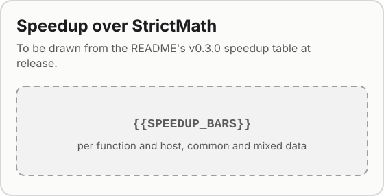
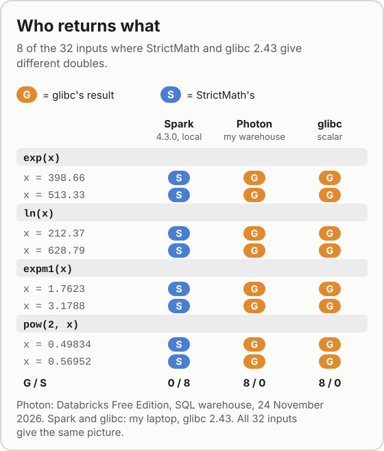
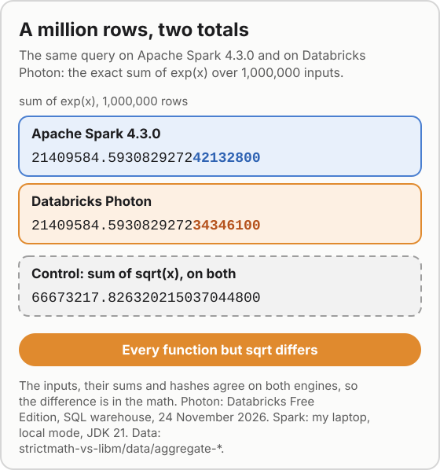
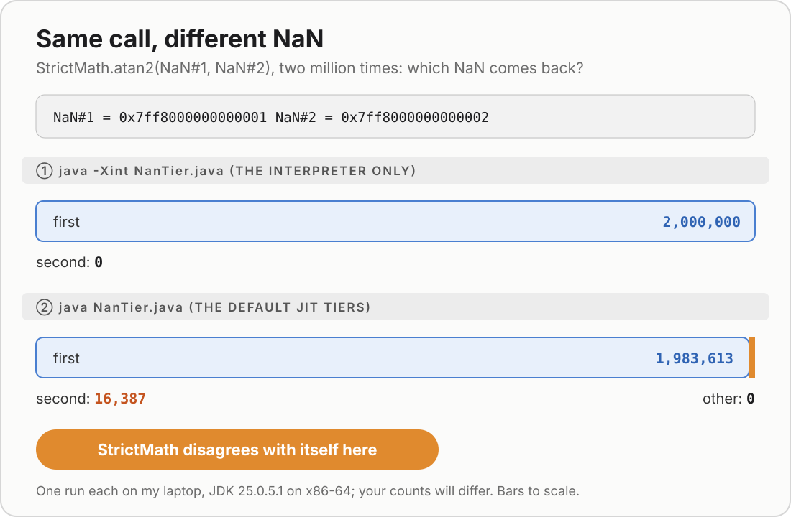
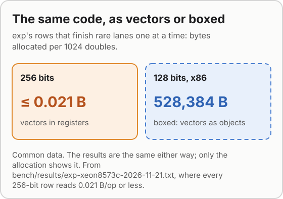
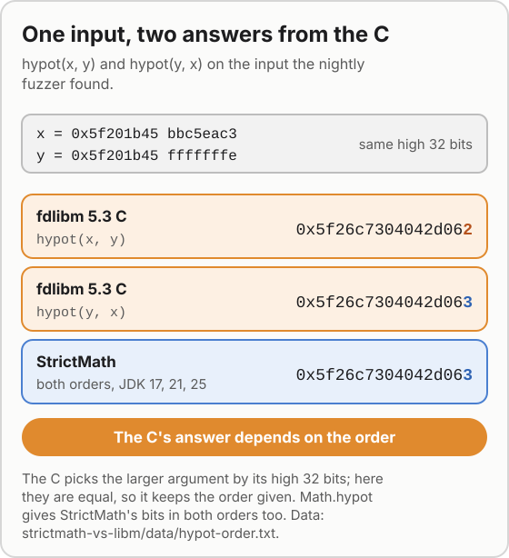
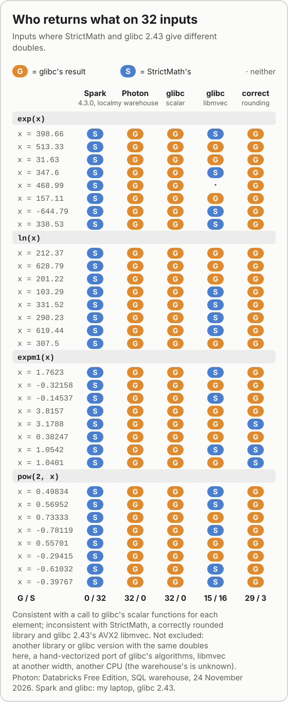

<!-- Set `date` to the real date when the post is published, and remove `published: false` at the
     release; until then Jekyll does not publish the post even if Pages is enabled. -->

<!-- A draft for vfdlibm 0.3.0. Every link to github.com/vecbricks/vfdlibm/blob/v0.3.0/ and
     tree/v0.3.0/ resolves only once the tag v0.3.0 exists, and the links to files under docs/blog/
     only if this branch is merged before the tag is made. -->
<!-- N in the title and in the first section must be a figure of the README's generated speedup
     table at v0.3.0: the largest "common" figure among the rows exp, log and pow in the xeon8573c
     (AVX-512) column, as the table prints it. Until that table exists there is no N; do not put in
     another figure. -->
<!-- The figures under img/ are written by figures.py from the data under strictmath-vs-libm/data/;
     edit the script, not the SVG files. -->

<div class="summary" markdown="1" style="border: 1px solid #d6d6d6; border-radius: 12px; padding: 4px 16px; margin-bottom: 1.5em;">

**In short.** [vfdlibm](https://github.com/vecbricks/vfdlibm) computes `exp`, `log`, `pow` and ten more functions on whole vectors of
doubles, and every result has the same bits as `java.lang.StrictMath`, which Spark calls for
`exp`, `ln`, `power` and their relatives. That matters because the bits differ elsewhere: on 32
test inputs on my Databricks Free Edition warehouse, Photon's results matched glibc's, not
Spark's.

</div>

## Faster, with the same bits

On the Intel Xeon Platinum 8573C (AVX-512), [vfdlibm](https://github.com/vecbricks/vfdlibm) computes `exp`, `log` and `pow` up to
{{N}}× faster than `StrictMath`, and every result has the same bits.

<!-- The figure img/speedup.svg is a placeholder: at release, make figures.py draw the bars from
     the README's v0.3.0 speedup table (and fill compare.svg's E placeholder the same way), then rerun it;
     do not edit the SVG files by hand. -->
[](img/speedup.svg)

These are timings of a loop over an array, not of a query: a query gains only as much as it spends
in these functions. The method that uses it is nine lines.

```java
static final VectorSpecies<Double> S = DoubleVector.SPECIES_PREFERRED;

static void exp(double[] xs, double[] ys) {
  int i = 0;
  for (; i < S.loopBound(xs.length); i += S.length()) {
    VFdlibm.exp(DoubleVector.fromArray(S, xs, i)).intoArray(ys, i);
  }
  for (; i < xs.length; i++) {
    ys[i] = StrictMath.exp(xs[i]); // the tail that does not fill a whole vector
  }
}
```

The loop loads a vector of doubles from `xs`, computes `exp` of all of them at once, and stores
the results in `ys`. The few doubles at the end that do not fill a vector go to `StrictMath`.
"How I checked" has the whole program, which checks a million results against `StrictMath`.

## Why your Spark job should care

When every engine returns the same doubles, a query gives the same answer after a migration, on a
new cluster or on a new CPU, and a test that compares doubles does not flake (one kind of NaN
aside, the first surprise below). `StrictMath` is how Spark gets there, and it computes one double
at a time.

## Spark's e is not Java's e

Spark computes `exp` with a different library than Java's `Math`, and you can see it in the last
digits.

Ask Java for e and you get `Math.E`, 2.718281828459045. Ask Spark SQL for `exp(1)` and you get
2.7182818284590455. The two are neighbours: no double lies between them.

Spark's generated code calls `java.lang.StrictMath` for `exp`, `ln`, `log10`, `power` and their
relatives, and `java.lang.Math` for the rest. The difference is a promise. `Math.exp` promises a
result "within 1 ulp of the exact result", where an ulp, a unit in the last place, is the gap
between a double and the next one. So it may return either neighbour, and the JIT, the compiler
inside the JVM, may use code written for your CPU. `StrictMath` promises one algorithm, Sun's fdlibm 5.3, a C library, and follows it almost everywhere (the third surprise below). The same
input gives the same 64 bits on every JVM and every CPU.

## Photon returned other doubles on my warehouse

On a SQL warehouse of mine on [Databricks Free Edition](https://www.databricks.com/learn/free-edition), Photon, Databricks' native query
engine, returned results that matched the C library's, not Spark's.

[](img/who-returns-what.svg)

I picked 32 inputs where `StrictMath` and glibc 2.43, the C library on my laptop, give different
doubles, and ran them through Apache Spark on my laptop and through Photon on 24 November 2026.
Spark matched `StrictMath` on every input. Photon matched glibc on every input. How often do the
two libraries disagree? On my random inputs, about one `exp` in ten.

[](img/how-often.svg)

A second query adds the results up. For each of nine functions it takes a million inputs and
returns an exact sum and a fingerprint of the results, so a change of one ulp in any row shows.
Its plan on Databricks is Photon from end to end. On Spark and on Photon the inputs, their sums and their fingerprints agree, and so does the `sqrt`
row, a control. Every other function's total differs. For seven of them, Photon's row equals,
digit for digit, a prediction made from glibc 2.43 on my laptop.

[](img/aggregate.svg)

<div class="box" markdown="1" style="border: 1px solid #d6d6d6; border-radius: 12px; padding: 0 16px; margin-top: 1em;">

### Check your own engine

Which doubles does your SQL engine return? Each row below holds an input and both libraries'
results, and `matches` says which one your engine returned. This is the form I ran on Databricks.
For personal use, [Free Edition](https://www.databricks.com/learn/free-edition), which Databricks says "is provided at no cost to all
users", is enough to run it; to check your company's engine, use your own workspace. On Apache
Spark without Delta, replace the first line with `DROP TABLE IF EXISTS tmp_photon_math` and
`CREATE TABLE tmp_photon_math (...) USING parquet`. Four of the 32 rows are shown;
[`photon-check.sql`](https://github.com/vecbricks/vfdlibm/blob/v0.3.0/docs/blog/photon-check.sql)
has them all. The second query to try is
[`aggregate-check.sql`](https://github.com/vecbricks/vfdlibm/blob/v0.3.0/docs/blog/aggregate-check.sql): it creates no table, runs as is in `spark-sql`
and in a Databricks SQL editor, and its comments say which rows to compare first.

```sql
CREATE OR REPLACE TABLE tmp_photon_math (f STRING, x DOUBLE, strictmath DOUBLE, libm DOUBLE);
INSERT INTO tmp_photon_math VALUES
  ('exp', 398.66376279136523D, 1.372373473676344e+173D, 1.3723734736763437e+173D),
  ('ln', 212.36641575624026D, 5.3583131589573565D, 5.358313158957356D),
  ('expm1', 1.7622825689472796D, 4.825719836785396D, 4.825719836785395D),
  ('pow', 0.4983392062672662D, 1.4125864924923173D, 1.412586492492317D);

SELECT f, x, photon,
       CASE WHEN photon = strictmath THEN 'StrictMath (Spark)'
            WHEN photon = libm THEN 'glibc libm'
            ELSE 'neither' END AS matches
FROM (
  SELECT f, x, strictmath, libm,
         CASE f WHEN 'exp' THEN exp(x) WHEN 'ln' THEN ln(x)
                WHEN 'expm1' THEN expm1(x) WHEN 'pow' THEN pow(2.0D, x) END AS photon
  FROM tmp_photon_math)
ORDER BY f, x;
```

</div>

## How vfdlibm keeps the bits

The Vector API (`jdk.incubator.vector`, still incubating in JDK 25) lets Java run one operation on
several doubles at once. Each double in a vector is a *lane*. The vector's size is its *species*:
a 512-bit species holds eight lanes.

vfdlibm ports fdlibm's C to that API. Version 0.3.0 has thirteen functions: `exp`, `expm1`, `log`,
`log10`, `log1p`, `pow`, `sinh`, `cosh`, `asin`, `acos`, `atan`, `atan2` and `hypot`.

[](img/one-call.svg)

A rare lane is one whose input sits at an edge of fdlibm's range, an infinity or a NaN. Six of the
thirteen functions are the ones Spark computes with `StrictMath`; for the other seven Spark calls
`Math`, and vfdlibm still returns `StrictMath`'s bits. The one exception, a lane of two different
NaNs, is the first surprise below.

## Why not `VectorOperators.EXP`?

The Vector API has its own `EXP`, but it promises accuracy, not `StrictMath`'s bits. Its Javadoc
says floating point operations "follow the accuracy and monotonicity specifications of the
equivalent Java operation or method", and `EXP` adds "Not guaranteed to be semi-monotonic." That is
the kind of promise `Math` makes. I have not measured how often `VectorOperators.EXP` differs from
`StrictMath`, or how fast it is.

[](img/compare.svg)

## Three surprises

### 1. StrictMath's NaN depends on the JIT

The same call can return a different NaN, depending on how far the JIT has compiled it.

A NaN, "not a number", carries spare bits, its payload. What should `atan2` return when both of
its arguments are NaNs with different payloads? This program,
[`NanTier.java`](https://github.com/vecbricks/vfdlibm/blob/v0.3.0/docs/blog/NanTier.java), asks
two million times:

```java
public class NanTier {
  public static void main(String[] a) {
    double x = Double.longBitsToDouble(0x7ff8000000000001L), y = Double.longBitsToDouble(0x7ff8000000000002L);
    long first = 0, second = 0, other = 0;
    for (int i = 0; i < 2_000_000; i++) {
      long r = Double.doubleToRawLongBits(StrictMath.atan2(x, y));
      if (r == 0x7ff8000000000001L) first++; else if (r == 0x7ff8000000000002L) second++; else other++;
    }
    System.out.println("atan2(NaN#1, NaN#2): first=" + first + " second=" + second + " other=" + other);
  }
}
```

One run each on my laptop, JDK 25.0.5.1 on x86-64 (your counts will differ):

```console
$ java -Xint NanTier.java
atan2(NaN#1, NaN#2): first=2000000 second=0 other=0
$ java NanTier.java
atan2(NaN#1, NaN#2): first=1983613 second=16387 other=0
```

[](img/nan-tier.svg)

In the interpreter, every call returned the first NaN. With the JIT on, some returned the second.
No code can match a target that moves. So in `atan2`, `hypot` and `pow`, a lane of two NaNs with
different bits returns one of the two, quieted (for `hypot`, with the sign cleared too), and which
one is not specified. Every other lane matches
`StrictMath` bit for bit.

### 2. Fast code can quietly turn into slow code

When the JIT cannot keep a vector in CPU registers, it turns the vector into an object on the
heap. That is called boxing. The results stay right, so every test still passes, but the vectors
no longer stay in registers. Only the allocation shows it.

[](img/boxing.svg)

So the project's CI fails a benchmark that allocates. It also reads the machine code the JIT emits for every
function and checks the register width, stray calls and fused multiply-adds. A fused multiply-add
computes `a * b + c` with one rounding instead of two, which changes results, so none may appear.

### 3. StrictMath is not quite fdlibm

`StrictMath` and fdlibm agree almost everywhere, and a vector port has to match the JDK, not the
C. On 24 November 2026, the nightly fuzzer found one input in about five billion where vfdlibm
was one ulp below `StrictMath.hypot`.

[](img/hypot-order.svg)

Sun's C picks the larger argument by comparing the top 32 bits of the two only:

```c
if(hb > ha) {a=y;b=x;j=ha; ha=hb;hb=j;} else {a=x;b=y;}
```

These two inputs share their top 32 bits, so the C keeps them in the order given, and its answer
depends on that order. `StrictMath.hypot` gives one answer in both orders, on JDK 17, 21 and 25,
and so does `Math.hypot`, which Spark calls. vfdlibm's port had followed the C exactly. In 0.3.0
it orders `hypot`'s arguments by magnitude, so its result no longer depends on their order, as
`StrictMath`'s does not ([{{PR}}]({{PR}})).

## What it does not do yet

`sin`, `cos`, `tan`, `tanh` and `cbrt` are not ported, and whether they will be is open. `pow`
computes its common case in the vector and sends the rest to `StrictMath.pow` one lane at a time,
`pow(x, 2.0)` and `pow(x, 0.5)` included. It needs JDK 25, where the Vector API is still an
incubator module. On x86, code on 128-bit vectors calls the Vector API's Java fallback. And at
`SPECIES_MAX`, only vectors of up to eight lanes are known not to allocate.

## Try it

`io.github.vecbricks:vfdlibm:0.3.0` is on Maven Central, and the source is at
[github.com/vecbricks/vfdlibm](https://github.com/vecbricks/vfdlibm).

{{VARKA: owner writes one or two sentences on Varka}}

## How I checked

The code, data and scripts below are in [vfdlibm's repository](https://github.com/vecbricks/vfdlibm), unless a link
points elsewhere.

**The speed numbers**
- Kernel timings from the README's [speedup table](https://github.com/vecbricks/vfdlibm/blob/v0.3.0/README.md),
  generated from committed benchmark files: `StrictMath` called once per lane against vfdlibm at the
  host's preferred species, by minimum time; where a file holds a run and its re-run, the lower of
  the two ratios. "Common" data has no rare lanes, "mixed" data has some.
- Hosts: GitHub-hosted virtual machines with an Intel Xeon Platinum 8573C (AVX-512) and an AMD EPYC
  7763 (AVX2). `exp`: {{row: exp xeon8573c}} on the Xeon, {{row: exp epyc7763}} on the EPYC.
- vfdlibm's body is inlined into the loop (`-XX:CompileCommand=inline,io.github.vecbricks.vfdlibm.*::*`),
  the project's fixed method; a call that the JIT does not inline passes its vectors as objects
  ([`PLAN.md`](https://github.com/vecbricks/vfdlibm/blob/v0.3.0/PLAN.md), section 2).

**The example program**
- The dependency is `io.github.vecbricks:vfdlibm:0.3.0` in a pom that compiles for Java 25 (the
  README has the [whole pom](https://github.com/vecbricks/vfdlibm/blob/v0.3.0/README.md#use)), run
  with `java --add-modules jdk.incubator.vector`. The full program:

```java
package example;

import io.github.vecbricks.vfdlibm.VFdlibm;
import jdk.incubator.vector.DoubleVector;
import jdk.incubator.vector.VectorSpecies;

public final class Main {
  static final VectorSpecies<Double> S = DoubleVector.SPECIES_PREFERRED;

  static void exp(double[] xs, double[] ys) {
    int i = 0;
    for (; i < S.loopBound(xs.length); i += S.length()) {
      VFdlibm.exp(DoubleVector.fromArray(S, xs, i)).intoArray(ys, i);
    }
    for (; i < xs.length; i++) {
      ys[i] = StrictMath.exp(xs[i]); // the tail that does not fill a whole vector
    }
  }

  public static void main(String[] args) {
    double[] xs = new double[1_000_003];
    double[] ys = new double[xs.length];
    for (int k = 0; k < xs.length; k++) {
      xs[k] = (k - 500_000) * 1e-3; // -500.0 to 500.002
    }
    exp(xs, ys);
    long differ = 0;
    for (int k = 0; k < xs.length; k++) {
      long want = Double.doubleToRawLongBits(StrictMath.exp(xs[k]));
      if (Double.doubleToRawLongBits(ys[k]) != want) {
        differ++;
      }
    }
    System.out.println(S.vectorBitSize() + "-bit vectors, " + xs.length
        + " inputs, results that differ from StrictMath's: " + differ);
  }
}
```

```bash
mvn -q compile org.apache.maven.plugins:maven-dependency-plugin:3.7.0:build-classpath \
  -Dmdep.outputFile=cp.txt
java --add-modules jdk.incubator.vector -cp "target/classes:$(cat cp.txt)" example.Main
```

- On my laptop, with 512-bit vectors, it printed a warning about the incubator module, then
  `512-bit vectors, 1000003 inputs, results that differ from StrictMath's: 0`.

**What Spark calls**
- [`mathExpressions.scala`](https://github.com/apache/spark/blob/v4.3.0/sql/catalyst/src/main/scala/org/apache/spark/sql/catalyst/expressions/mathExpressions.scala)
  at Spark 4.3.0. The base class
  [`UnaryMathExpression`](https://github.com/apache/spark/blob/v4.3.0/sql/catalyst/src/main/scala/org/apache/spark/sql/catalyst/expressions/mathExpressions.scala#L66-L87)
  generates `java.lang.Math.<name>(x)`; `Exp`, `Expm1` and `Pow` override it with `StrictMath`
  ([L571](https://github.com/apache/spark/blob/v4.3.0/sql/catalyst/src/main/scala/org/apache/spark/sql/catalyst/expressions/mathExpressions.scala#L571-L576),
  [L592](https://github.com/apache/spark/blob/v4.3.0/sql/catalyst/src/main/scala/org/apache/spark/sql/catalyst/expressions/mathExpressions.scala#L592-L597),
  [L1428](https://github.com/apache/spark/blob/v4.3.0/sql/catalyst/src/main/scala/org/apache/spark/sql/catalyst/expressions/mathExpressions.scala#L1428-L1435));
  `Log`, `Log10` and `Log1p` inherit it from
  [`UnaryLogExpression`](https://github.com/apache/spark/blob/v4.3.0/sql/catalyst/src/main/scala/org/apache/spark/sql/catalyst/expressions/mathExpressions.scala#L89-L115).
  The interpreted path is passed the same functions, such as `UnaryMathExpression(StrictMath.exp, "EXP")`.

[](img/spark-emits.svg)

**Java's promises and the bits of e**
- The JDK 25 Javadoc of
  [`Math`](https://docs.oracle.com/en/java/javase/25/docs/api/java.base/java/lang/Math.html) says its
  implementations "are not defined to return the bit-for-bit same results"; that of
  [`StrictMath`](https://docs.oracle.com/en/java/javase/25/docs/api/java.base/java/lang/StrictMath.html)
  says "The Java math library is defined with respect to fdlibm version 5.3."
- [`VectorOperators`](https://docs.oracle.com/en/java/javase/25/docs/api/jdk.incubator.vector/jdk/incubator/vector/VectorOperators.html),
  section "Operations on floating point vectors", for the `EXP` quotes.
- [`ExpOne.java`](https://github.com/vecbricks/vfdlibm/blob/v0.3.0/docs/blog/strictmath-vs-libm/ExpOne.java)
  prints the bits of `StrictMath.exp(1)` and `Math.E`:

[](img/exp1-bits.svg)

**The Photon run**: [Databricks Free Edition](https://www.databricks.com/learn/free-edition), SQL warehouse with Photon, 24 November 2026
- A query of literals, `SELECT EXP(1), LOG(E(), 10), pow(2, 0.5), EXPM1(1.0E-5)`, returned
  2.7182818284590455, 2.302585092994046, 1.4142135623730951 and 0.000010000050000166668: the first
  is `StrictMath`'s `exp(1)`. Spark's optimizer folds constant expressions on the driver, in the JVM,
  so this query does not exercise Photon. I have not yet compared a literal with the same value read
  from a column.
  <!-- {{LITERAL_VS_COLUMN}}: owner to run SELECT exp(1.0D), (SELECT exp(x) FROM tmp_math WHERE x = 1.0D) and add the result if they differ -->
- For a query over a table column, `EXPLAIN` showed `PhotonProject [... EXP(x), ln(x), pow(2.0, x), EXPM1(x)]`
  over `PhotonScan parquet` and said "The query is fully supported by Photon."
- The test is [`photon-check.sql`](https://github.com/vecbricks/vfdlibm/blob/v0.3.0/docs/blog/photon-check.sql);
  Photon's output, as pasted from the SQL editor, is `strictmath-vs-libm/data/photon-2026-11-24.csv`, and on every row
  it equals the file's `libm` column.
- Apache Spark 4.3.0's `spark-sql` (the official `spark-4.3.0-bin-hadoop3.tgz`, checked against
  Apache's SHA-512) in local mode on JDK 21, on my laptop, ran the same file with a parquet table;
  every row matched `StrictMath` (`strictmath-vs-libm/data/spark-4.3.0-local-2026-11-24.csv`, with
  the download, hash check and run in `spark-4.3.0-local-provenance.txt` beside it).

**Narrowing it down: all 32 inputs**

[](img/who-returns-what-full.svg)

- Correct rounding: [`rounding.py`](https://github.com/vecbricks/vfdlibm/blob/v0.3.0/docs/blog/strictmath-vs-libm/rounding.py)
  computes each result with Python's `decimal` at 80 digits and rounds it to a double. glibc's value
  is the correctly rounded one on 29 of the 32; `StrictMath`'s on 3, all `expm1`, at
  3.178803427426695, 1.0542424180475716 and 1.0400925680121542. Photon matched glibc on those 3 too,
  which accuracy alone would not explain.
- glibc's vector library: [`libmvec.c`](https://github.com/vecbricks/vfdlibm/blob/v0.3.0/docs/blog/strictmath-vs-libm/libmvec.c)
  calls glibc 2.43's AVX2 functions `_ZGVdN4v_exp`, `_ZGVdN4v_log`, `_ZGVdN4v_expm1` and
  `_ZGVdN4vv_pow`; they differ from scalar glibc on 17 of the 32 (5 `exp`, 4 `ln`, 3 `expm1`, 5
  `pow`). For `pow(2, 0.4983392062672662)`, libmvec gives 1.4125864924923173 and scalar glibc
  1.412586492492317. Photon matched the scalar values on all 32.
- So on these 32 inputs of `exp`, `ln`, `expm1` and `pow`, Photon's results on my Free Edition
  warehouse are consistent with a call to glibc's scalar functions for each element, and inconsistent with `StrictMath`, with a correctly rounded library, and with glibc
  2.43's AVX2 libmvec. They do not exclude another library, or another glibc version, that returns
  the same doubles on these inputs, a hand-vectorized port of glibc's algorithms, libmvec at another
  width, or another CPU: I do not know the warehouse's CPU. The aggregate query below shows one
  function, `cbrt`, where Photon's results match neither glibc 2.43 nor Spark.
- The rates: [`Gen.java` and `compare.py`](https://github.com/vecbricks/vfdlibm/tree/v0.3.0/docs/blog/strictmath-vs-libm),
  200,000 inputs drawn uniformly between -700 and 700 from seed 7, with `ln` of the absolute value,
  `expm1` of x/100 and `pow(2.0, x/700)`; Python's `math` module calls the C library.
- Other engines do not promise `StrictMath`'s bits either. NVIDIA's
  [cuDF plugin for Apache Spark](https://nvidia.github.io/cudf-spark/docs/compatibility.html) says:
  "For other functions like sin, cos, etc. the output may be different, but within the rounding
  error inherent in floating-point calculations." Velox's Presto `exp` calls `std::exp`
  ([`ExpFunction`](https://github.com/facebookincubator/velox/blob/b0706264be6ce974388fc263197c2a9e013416d2/velox/functions/prestosql/Arithmetic.h#L336-L340)).
- [`figures.py`](https://github.com/vecbricks/vfdlibm/blob/v0.3.0/docs/blog/figures.py) draws the
  data figures from committed files: `strictmath-vs-libm/data/`, the benchmark file named below and
  fdlibm's `e_hypot.c`.

**The aggregate query**
- [`aggregate-check.sql`](https://github.com/vecbricks/vfdlibm/blob/v0.3.0/docs/blog/aggregate-check.sql) builds 1,000,000 inputs per function from
  `range()`'s `id`, so no engine can fold a call to a constant, and reduces each function's results
  to order-independent aggregates: the exact sum of every result cast to `DECIMAL(38,18)` and a
  `bit_xor` of `xxhash64` over the results' bits. `cast_lossy` is 0 on every row, so each result's
  cast reads back as the same double, and a one-ulp change moves `sum_y`. `sum_x` is a control sum
  of the arguments, rounded to the decimal's scale, not an exact one.
- The controls agree: `xor_x` and `sum_x`, the inputs' fingerprint and sum, are the same on Photon
  and on Spark for every function, and so is the whole `sqrt` row. So the inputs, the casts and the
  hashes agree, and the differences are in the functions' results.
- Photon: Databricks Free Edition, SQL warehouse with Photon, 24 November 2026, its output as
  pasted from the SQL editor (`data/aggregate-photon-2026-11-24.csv`). `EXPLAIN`, run separately
  on the same query and warehouse the same day (`data/aggregate-photon-explain-2026-11-24.txt`),
  shows only Photon operators, from `PhotonRange` through `PhotonProject`, `PhotonUnion` and
  `PhotonGroupingAgg` to `PhotonSort`, and ends "The query is fully supported by Photon." The
  query profile was not recorded. Spark: Apache Spark 4.3.0,
  local mode, on JDK 21 and on JDK 25 (`data/aggregate-spark-4.3.0-jdk21.tsv`, `-jdk25.tsv`). The
  glibc prediction: [`aggregate-glibc-values.c`](https://github.com/vecbricks/vfdlibm/blob/v0.3.0/docs/blog/strictmath-vs-libm/aggregate-glibc-values.c)
  computes every result with glibc 2.43 on my laptop, and
  [`aggregate-predict-glibc.sql`](https://github.com/vecbricks/vfdlibm/blob/v0.3.0/docs/blog/strictmath-vs-libm/aggregate-predict-glibc.sql) runs the same
  aggregates over them in Spark (`data/aggregate-glibc-2.43-predicted-jdk21.tsv`, `-jdk25.tsv`).
- The comparison, every column of each row; the last column counts the inputs where Spark on JDK 21
  and glibc 2.43 return different doubles:

| Function | Spark calls | Photon = Spark (JDK 21) | Photon = glibc 2.43 prediction | Rows where Spark and glibc differ |
|---|---|---|---|---|
| `exp` | `StrictMath` | no | yes | 97,775 |
| `expm1` | `StrictMath` | no | yes | 1,348 |
| `ln` | `StrictMath` | no | yes | 19,392 |
| `log10` | `StrictMath` | no | yes | 2,906 |
| `pow` | `StrictMath` | no | yes | 96,629 |
| `sin` | `Math` | no | yes | 1,785 |
| `tanh` | `Math` | no | yes | 95 |
| `cbrt` | `Math` | no | no | 508,235 |
| `sqrt` | `Math` | yes | yes | 0 |

- For `exp`, the sum is 21409584.593082927242132800 on Spark and 21409584.593082927234346100 on
  Photon, which is also the glibc prediction's.
- `cbrt`: Photon's row matches neither glibc 2.43 nor Spark on either JDK. Its sum,
  75000024.722734006601528900, equals to the last digit the sum of the correctly rounded cube roots,
  computed by [`aggregate-cbrt-cr.py`](https://github.com/vecbricks/vfdlibm/blob/v0.3.0/docs/blog/strictmath-vs-libm/aggregate-cbrt-cr.py): consistent with
  correct rounding on these inputs. `std::cbrt` built on my laptop does not reproduce it either:
  [`aggregate-std-cbrt.cpp`](https://github.com/vecbricks/vfdlibm/blob/v0.3.0/docs/blog/strictmath-vs-libm/aggregate-std-cbrt.cpp), built 11 ways with g++ 15.2.0 and clang
  21.1.8 against glibc 2.43 (from `-O0` to `-O3 -ffast-math -march=native`, libstdc++ and libc++),
  gives either the glibc prediction's total or 75000024.722734010199381500, never Photon's
  (`data/aggregate-std-cbrt-2026-11-24.txt`).
- `sin`, `tanh` and `cbrt` go to `java.lang.Math` in Spark, so Spark's own rows for them depend on
  the JDK (and, for `Math`, possibly the CPU): on my laptop `tanh` and `cbrt` give different results
  on JDK 21 and JDK 25. The table compares with JDK 21.

**The NaN exception and the contract**
- In `atan2`, `hypot` and `pow`, a lane of two NaNs with different bits returns one of the two
  arguments' bits with the quiet bit set (for `hypot`, also with the sign cleared): see
  [`AGENTS.md`, "Releases"](https://github.com/vecbricks/vfdlibm/blob/v0.3.0/AGENTS.md#releases).
  The NaN counts are in `strictmath-vs-libm/data/nantier-jdk-25.0.5.1.txt`.

**Boxing and the machine code**
- The allocation figures are `exp`'s finish rows on common data in
  [`exp-xeon8573c-2026-11-21.txt`](https://github.com/vecbricks/vfdlibm/blob/v0.3.0/bench/results/exp-xeon8573c-2026-11-21.txt).
- CI's allocation check runs at 256 bits, the preferred species and `SPECIES_MAX` (read as
  allocation-free up to eight lanes only), and fails a row that reaches one byte per operation;
  128 bits on x86 is known to box and is left out, and `pow` is held to a baseline, since
  `StrictMath.pow` allocates itself.
- `AsmTest` ([`SKILLS.md`, "The assembly check"](https://github.com/vecbricks/vfdlibm/blob/v0.3.0/SKILLS.md#the-assembly-check))
  reads what the JIT emits; its rule on calls holds from 256 bits up.

**hypot's old words**
- For a subnormal argument fdlibm's `hypot` may scale both values by 2^1022 and keep reading the
  high words, the top 32 bits, it took before scaling; reading them again changes the result on some
  inputs. [`PROOFS.md`'s L16](https://github.com/vecbricks/vfdlibm/blob/v0.3.0/PROOFS.md#l16-the-stale-words-of-the-21022-scaling-cannot-be-refreshed-a-counter-example-not-a-fold)
  has four such inputs and a count, and the lines are in
  [this figure](img/hypot-stale.svg); the vector code keeps the old words, as the C does
  ([`HypotTest`](https://github.com/vecbricks/vfdlibm/blob/v0.3.0/src/test/java/io/github/vecbricks/vfdlibm/HypotTest.java)).

**hypot's argument order**
- The nightly run [45355169208](https://github.com/vecbricks/vfdlibm/actions/runs/45355169208),
  job "fuzz (hypot, runner flags)", on 24 November 2026 on an AMD EPYC 9V74 runner (AVX2), found
  one input in 5,454,200,832 at 256 bits, the same input at the widest species:
  x = `0x5f201b45bbc5eac3`, y = `0x5f201b45fffffffe`. `StrictMath` gave `0x5f26c7304042d063`,
  vfdlibm `0x5f26c7304042d062`, one ulp below ([#173](https://github.com/vecbricks/vfdlibm/issues/173)).
- [`hypot-order.c`](https://github.com/vecbricks/vfdlibm/blob/v0.3.0/docs/blog/strictmath-vs-libm/hypot-order.c) calls Sun's C from
  [`reference/fdlibm-5.3/e_hypot.c`](https://github.com/vecbricks/vfdlibm/blob/v0.3.0/reference/fdlibm-5.3/e_hypot.c)
  (line 60 is the comparison quoted above), built with gcc 15.2.0 and
  `-O0 -ffp-contract=off -fno-builtin -fno-strict-aliasing -D__LITTLE_ENDIAN`: `hypot(x, y)` is
  `…d062` and `hypot(y, x)` is `…d063`. [`HypotOrder.java`](https://github.com/vecbricks/vfdlibm/blob/v0.3.0/docs/blog/strictmath-vs-libm/HypotOrder.java) gives `…d063` for
  `StrictMath.hypot` and `Math.hypot` in both orders on JDK 17.0.21.1, 21.0.13.1 and 25.0.5.1.
  Both outputs are in `strictmath-vs-libm/data/hypot-order.txt`.
- [`HypotPairs.java`](https://github.com/vecbricks/vfdlibm/blob/v0.3.0/docs/blog/strictmath-vs-libm/HypotPairs.java) and [`HypotPairsEdges.java`](https://github.com/vecbricks/vfdlibm/blob/v0.3.0/docs/blog/strictmath-vs-libm/HypotPairsEdges.java)
  draw 1,300,000 pairs whose magnitudes share their high 32 bits, and
  [`hypot-order-check.c`](https://github.com/vecbricks/vfdlibm/blob/v0.3.0/docs/blog/strictmath-vs-libm/hypot-order-check.c) compares `StrictMath` with the C called with the
  larger magnitude first: they differ only on two pairs, both of two NaNs (the contract's
  exception). On these random pairs the C's own answer depended on the order only for pairs of two
  NaNs, so they test the rule less than the fuzzer's input does
  (`strictmath-vs-libm/data/hypot-pairs.txt`).
- [JDK-7130085](https://bugs.openjdk.org/browse/JDK-7130085), "Port fdlibm hypot to Java" (JDK 9,
  2015), replaced the JDK's native C `hypot` with a Java port. The JDK's own tests,
  [`HypotTests.java`](https://github.com/openjdk/jdk/blob/jdk-25-ga/test/jdk/java/lang/StrictMath/HypotTests.java)
  at JDK 25, require `hypot(a, b) == hypot(b, a)`. I ran only JDK 17, 21 and 25.

**How the bits are kept**
- Ported from Sun's fdlibm 5.3 C sources only, never from OpenJDK's `FdLibm.java` (GPLv2 with the
  Classpath exception); `StrictMath` is only the oracle the tests call.
- Where the code computes differently from the C, a numbered lemma in
  [`PROOFS.md`](https://github.com/vecbricks/vfdlibm/blob/v0.3.0/PROOFS.md) argues the result is the
  same double for every input; the one place the code leaves the C, to match `StrictMath`, is
  `hypot`'s argument order (the third surprise). Parts of those for `exp`, `log` and `expm1` are machine-checked in
  [`proofs/`](https://github.com/vecbricks/vfdlibm/tree/v0.3.0/proofs), by an SMT solver on every
  pull request and under Z3 and cvc5 every night.
- Tests compare every lane with `StrictMath` at every width the host has, on hard cases from
  Lefèvre's tables and CORE-MATH's MIT lists among others; each planted fault, a deliberate bug
  switched on in a test run, must be caught.
- [`nightly.yml`](https://github.com/vecbricks/vfdlibm/blob/v0.3.0/.github/workflows/nightly.yml)
  is set to sweep all 2^32 high words of every function, three low words each: on x86 at 256 bits,
  the widest species, and 512 bits when the runner has AVX-512; on Arm at 128 bits; at 128 bits on x86
  a rotating 1/32 a night; one argument a night for a function of two. A fuzzer draws inputs from a
  fresh seed at every width.

**What comes next**
- The five functions not ported: [#162](https://github.com/vecbricks/vfdlibm/issues/162). The
  decision on `pow`'s lanes: [#34](https://github.com/vecbricks/vfdlibm/issues/34). Profiles of
  where the time goes: [#156](https://github.com/vecbricks/vfdlibm/issues/156).
