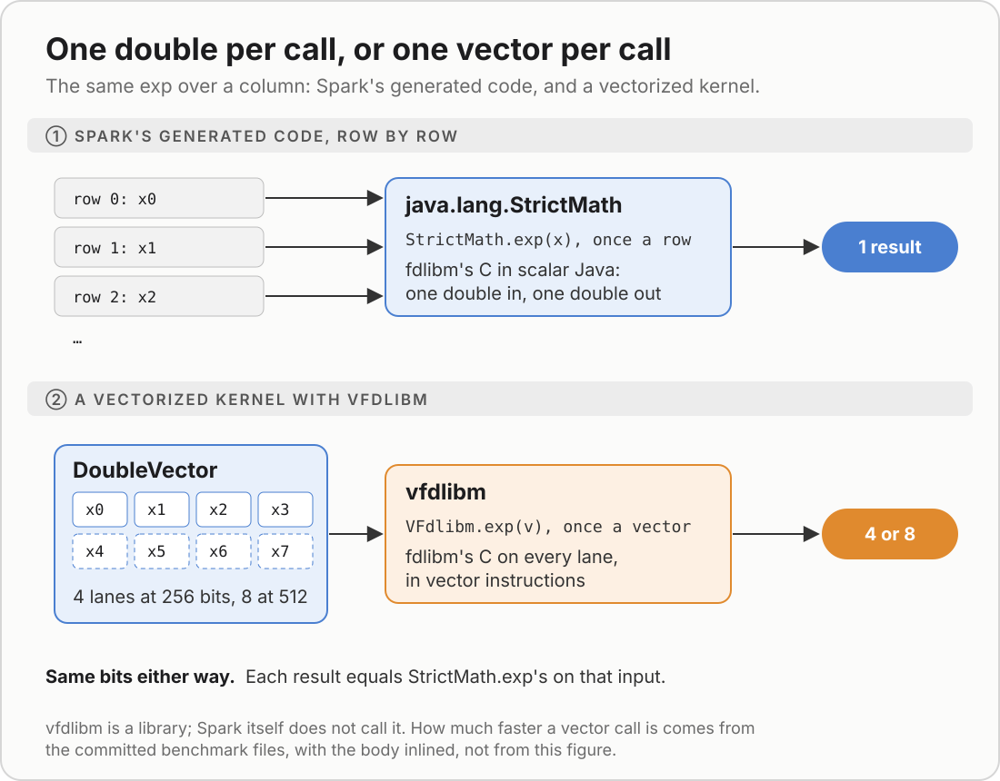
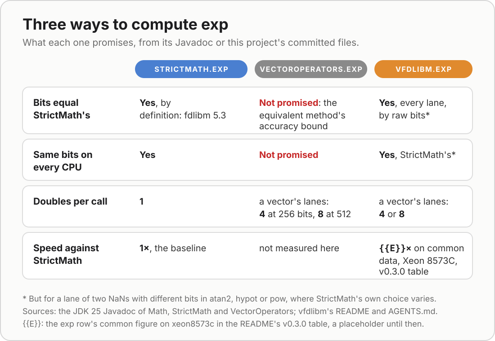

<!-- Set `date` to the real date when the post is published, and remove `published: false` at the
     release; until then Jekyll does not publish the post even if Pages is enabled. -->

<!-- A draft for vfdlibm 0.3.0. Every link to github.com/vecbricks/vfdlibm/blob/v0.3.0/ and
     tree/v0.3.0/ resolves only once the tag v0.3.0 exists, and the link to docs/blog/NanTier.java
     only if this branch is merged before the tag is made, as do the links to
     docs/blog/photon-check.sql and docs/blog/strictmath-vs-libm/. -->
<!-- N in the title must be a figure of the README's generated speedup table at v0.3.0: the
     largest "common" figure among the rows exp, log and pow in the xeon8573c (AVX-512) column,
     as the table prints it. Until that table exists there is no N; do not put in another figure. -->

Ask Java for e and you get `Math.E`, 2.718281828459045. Ask Spark SQL for `exp(1)` and you get
2.7182818284590455, the next double up. Spark does not compute `exp`, `ln` or `power` with
`java.lang.Math`. It computes them with `java.lang.StrictMath`, and it asks for it on purpose.

That choice gives Spark a guarantee: the same bits on every executor, every JVM and every CPU.
It also means the call runs on one double at a time. I wrote a library that keeps the guarantee
and computes several doubles at once. This post is about version 0.3.0, and about three things
that surprised me while I wrote it.

## Spark asks for StrictMath

The file is
[`mathExpressions.scala`](https://github.com/apache/spark/blob/v4.3.0/sql/catalyst/src/main/scala/org/apache/spark/sql/catalyst/expressions/mathExpressions.scala)
(Spark 4.3.0). Its base class for one-argument functions,
[`UnaryMathExpression`](https://github.com/apache/spark/blob/v4.3.0/sql/catalyst/src/main/scala/org/apache/spark/sql/catalyst/expressions/mathExpressions.scala#L66-L87),
generates `java.lang.Math.<name>(x)` by default. `Exp` and `Expm1` override that generated code to
emit `java.lang.StrictMath.exp` and `java.lang.StrictMath.expm1`
([L571](https://github.com/apache/spark/blob/v4.3.0/sql/catalyst/src/main/scala/org/apache/spark/sql/catalyst/expressions/mathExpressions.scala#L571-L576),
[L592](https://github.com/apache/spark/blob/v4.3.0/sql/catalyst/src/main/scala/org/apache/spark/sql/catalyst/expressions/mathExpressions.scala#L592-L597)).
`Log`, `Log10` and `Log1p` extend
[`UnaryLogExpression`](https://github.com/apache/spark/blob/v4.3.0/sql/catalyst/src/main/scala/org/apache/spark/sql/catalyst/expressions/mathExpressions.scala#L89-L115),
whose generated code is `java.lang.StrictMath.<name>(x)`. `Pow`, SQL's `power`, overrides its base
class the same way to emit `java.lang.StrictMath.pow`
([L1428](https://github.com/apache/spark/blob/v4.3.0/sql/catalyst/src/main/scala/org/apache/spark/sql/catalyst/expressions/mathExpressions.scala#L1428-L1435)).
The interpreted path gets the same functions: `UnaryMathExpression(StrictMath.exp, "EXP")`,
`UnaryLogExpression(StrictMath.log, "LOG")`, `BinaryMathExpression(StrictMath.pow, "POWER")`.

Why does that matter? `Math` is allowed to differ, so that it can be faster. Its Javadoc says
that its implementations "are not defined to return the bit-for-bit same results", and `Math.exp`
promises only that "the computed result must be within 1 ulp of the exact result". An ulp, a
unit in the last place, is the gap between a double and the next one. So `Math.exp` may give
either neighbour of the exact value, and the JIT may give it from code written for your CPU.
`StrictMath` is defined by one published algorithm: "The Java math library is defined with
respect to fdlibm version 5.3." fdlibm is Sun's Freely Distributable Math Library, written in
C. The same input gives the same 64 bits everywhere, so a query run on another cluster returns
the same doubles, and a test that compares them passes there too.

## What a Photon warehouse returns

I wanted to see what this looks like outside the JVM, so on 24 November 2026 I ran queries on my
own Databricks SQL warehouse with Photon.

The first was `SELECT EXP(1), LOG(E(), 10), pow(2, 0.5), EXPM1(1.0E-5)`. It returned
2.7182818284590455, 2.302585092994046, 1.4142135623730951 and 0.000010000050000166668. The first is
StrictMath's `exp(1)`. On JDK 25, `Math.exp(1)` is 2.718281828459045, and so is `exp(1)` in glibc
2.43, the C library on my laptop. But a query of literals shows little: Spark's optimizer folds
constant expressions on the driver, in the JVM, so this query does not exercise Photon. I have not
yet compared a literal with the same value read from a column.

<!-- {{LITERAL_VS_COLUMN}}: owner to run SELECT exp(1.0D), (SELECT exp(x) FROM tmp_math WHERE x = 1.0D) and add the result if they differ -->

Then I read the inputs from a table column. For such a query, `EXPLAIN` showed
`PhotonProject [... EXP(x), ln(x), pow(2.0, x), EXPM1(x)]` over `PhotonScan parquet`, and said
"The query is fully supported by Photon." The test,
[`photon-check.sql`](https://github.com/vecbricks/vfdlibm/blob/v0.3.0/docs/blog/photon-check.sql),
holds 32 inputs, eight each for `exp`, `ln`, `expm1` and `pow(2.0, x)`, where JDK 25's `StrictMath`
and glibc 2.43's libm give different doubles, with both results beside each input. On my
workspace, on 24 November 2026, Photon's results matched the C library's (the `libm` column,
computed with glibc 2.43) on all 32, and `StrictMath`'s on none. You can run the same file on your
own engine; the end of this post has it too.

How often do the two libraries differ? On 200,000 random inputs, `x` drawn uniformly between -700
and 700 from seed 7, `StrictMath` and glibc 2.43 differ on 19,720 for `exp(x)`, 19,627 for
`pow(2.0, x/700)`, 4,047 for `ln(abs(x))` and 139 for `expm1(x/100)`. The generator and the
comparison are in
[`strictmath-vs-libm/`](https://github.com/vecbricks/vfdlibm/tree/v0.3.0/docs/blog/strictmath-vs-libm).

Matching glibc on 32 inputs could mean merely that Photon is accurate, so I ran two more tests on
the same 32 inputs, on my laptop.

First, which answer is correctly rounded, the double nearest the exact value? Computed with
Python's `decimal` at 80 digits ([`rounding.py`](https://github.com/vecbricks/vfdlibm/blob/v0.3.0/docs/blog/strictmath-vs-libm/rounding.py)), glibc's
value is the correctly rounded one on 29 of the 32 and `StrictMath`'s on 3, all three `expm1`:
at 3.178803427426695, 1.0542424180475716 and 1.0400925680121542. Photon matched glibc on all 32,
these 3 included, which accuracy alone would not explain.

Second, glibc also has a vector library, libmvec. Its AVX2 functions (`_ZGVdN4v_exp`,
`_ZGVdN4v_log`, `_ZGVdN4v_expm1` and `_ZGVdN4vv_pow`, in [`libmvec.c`](https://github.com/vecbricks/vfdlibm/blob/v0.3.0/docs/blog/strictmath-vs-libm/libmvec.c)) differ from
scalar glibc on 17 of the 32: 5 for `exp`, 4 for `ln`, 3 for `expm1` and 5 for `pow`. For
`pow(2, 0.4983392062672662)`, libmvec gives 1.4125864924923173 and scalar glibc
1.412586492492317. Photon matched the scalar values on all 32.

So Photon's results on my workspace are consistent with a call to glibc's scalar functions for
each element, and inconsistent with Spark's `StrictMath`, with a correctly rounded library, and
with glibc 2.43's AVX2 libmvec. They do not exclude another library, or another glibc version,
that returns the same doubles on these inputs, a hand-vectorized port of glibc's algorithms,
libmvec at another width, or another CPU: I do not know the warehouse's CPU.

Other engines do not promise `StrictMath`'s bits either. The compatibility guide of NVIDIA's
[cuDF plugin for Apache Spark](https://nvidia.github.io/cudf-spark/docs/compatibility.html) says:
"For other functions like sin, cos, etc. the output may be different, but within the rounding
error inherent in floating-point calculations." And in Velox's code, its Presto `exp`,
[`ExpFunction`](https://github.com/facebookincubator/velox/blob/b0706264be6ce974388fc263197c2a9e013416d2/velox/functions/prestosql/Arithmetic.h#L336-L340),
calls `std::exp`. vfdlibm is for an engine that wants the speed of vectors and Spark's own bits.

## vfdlibm

The Vector API (`jdk.incubator.vector`, still incubating in JDK 25) lets Java run one operation
on several doubles at once. Each double is a *lane* of a vector, and the vector's shape is its
*species*: a 512-bit species holds eight lanes, a 256-bit one four.

vfdlibm ports fdlibm 5.3's C to that API, one function at a time. 0.3.0 has the thirteen
functions on its plan: `exp`, `expm1`, `log`, `log10`, `log1p`, `pow`, `sinh`, `cosh`, `asin`,
`acos`, `atan`, `atan2` and `hypot`. `hypot` and `pow` are new in this release. The contract is
that every lane equals `StrictMath`'s result on that input, compared by
`Double.doubleToRawLongBits`. It has one exception, and the first surprise below explains it.

[](img/row-vs-vector.svg)

Inside a call, fdlibm's own branch tests sort the lanes. A lane in the function's ordinary range
is computed by the vector body, which is fdlibm's C operation by operation. In most functions, a
rare lane (an argument at the edge of the range, an infinity or a NaN) is computed again by
`StrictMath` itself, one lane at a time, and that result is written over the lane.

[](img/one-call.svg)

## Nine lines of code

The dependency is `io.github.vecbricks:vfdlibm:0.3.0`, in a pom that compiles for Java 25
(`<maven.compiler.release>25</maven.compiler.release>`; the README has the
[whole pom](https://github.com/vecbricks/vfdlibm/blob/v0.3.0/README.md#use)):

```xml
<dependency>
  <groupId>io.github.vecbricks</groupId>
  <artifactId>vfdlibm</artifactId>
  <version>0.3.0</version>
</dependency>
```

The loop that matters is the nine lines of `exp` below. It reads a vector of the preferred
species from `xs`, computes it and writes the result to `ys`. The few doubles left at the end of
the array go to `StrictMath` one at a time. `main` checks every result against `StrictMath`:

```java
package example;

import io.github.vecbricks.vfdlibm.VFdlibm;
import jdk.incubator.vector.DoubleVector;
import jdk.incubator.vector.VectorSpecies;

public final class Main {
  static final VectorSpecies<Double> S = DoubleVector.SPECIES_PREFERRED;

  static void exp(double[] xs, double[] ys) {
    int i = 0;
    for (; i < S.loopBound(xs.length); i += S.length()) {
      VFdlibm.exp(DoubleVector.fromArray(S, xs, i)).intoArray(ys, i);
    }
    for (; i < xs.length; i++) {
      ys[i] = StrictMath.exp(xs[i]); // the tail that does not fill a whole vector
    }
  }

  public static void main(String[] args) {
    double[] xs = new double[1_000_003];
    double[] ys = new double[xs.length];
    for (int k = 0; k < xs.length; k++) {
      xs[k] = (k - 500_000) * 1e-3; // -500.0 to 500.002
    }
    exp(xs, ys);
    long differ = 0;
    for (int k = 0; k < xs.length; k++) {
      long want = Double.doubleToRawLongBits(StrictMath.exp(xs[k]));
      if (Double.doubleToRawLongBits(ys[k]) != want) {
        differ++;
      }
    }
    System.out.println(S.vectorBitSize() + "-bit vectors, " + xs.length
        + " inputs, results that differ from StrictMath's: " + differ);
  }
}
```

The JVM does not resolve an incubating module unless told to, so the run adds it:

```sh
mvn -q compile org.apache.maven.plugins:maven-dependency-plugin:3.7.0:build-classpath \
  -Dmdep.outputFile=cp.txt
java --add-modules jdk.incubator.vector -cp "target/classes:$(cat cp.txt)" example.Main
```

On my laptop, which has 512-bit vectors, it prints a warning that an incubator module is in use,
then:

```
512-bit vectors, 1000003 inputs, results that differ from StrictMath's: 0
```

The README has the
[full client example](https://github.com/vecbricks/vfdlibm/blob/v0.3.0/README.md#use), with
the masked form, `exp(x, live)`, and the module path.

## How much faster

The README's [speedup table](https://github.com/vecbricks/vfdlibm/blob/v0.3.0/README.md) is
generated from committed benchmark files and checked by CI. Its `exp` figures for each host:


- `exp` on the Intel Xeon Platinum 8573C (AVX-512): {{row: exp xeon8573c}}
- `exp` on the AMD EPYC 7763 (AVX2): {{row: exp epyc7763}}


Each figure is `StrictMath` called once per lane against vfdlibm at the host's preferred species, by
minimum time; where a file holds a run and its re-run, the lower of the two ratios. The hosts are
GitHub-hosted virtual machines. The benchmarks run with vfdlibm's body inlined into the loop
(`-XX:CompileCommand=inline,io.github.vecbricks.vfdlibm.*::*`), the project's fixed method: a
function body is large, and a call that C2 does not inline passes its vectors as objects
([`PLAN.md`](https://github.com/vecbricks/vfdlibm/blob/v0.3.0/PLAN.md), section 2), as the third
surprise below explains. "Common" data is data on which no lane takes a rare path of the function,
and "mixed" data has rare lanes in it (huge arguments, subnormals, special cases). They are timings
of a kernel, not of a query: what a Spark query gains depends on how much of its time it spends in
these functions.

## Why not `VectorOperators.EXP`?

The Vector API has its own `EXP`, `LOG` and `POW`. Their Javadoc, in the section ["Operations on
floating point
vectors"](https://docs.oracle.com/en/java/javase/25/docs/api/jdk.incubator.vector/jdk/incubator/vector/VectorOperators.html),
says what they promise:

> Lane-wise vector operations that apply to floating point vectors follow the accuracy and
> monotonicity specifications of the equivalent Java operation or method mentioned in its
> documentation unless specified otherwise.

And the text of `EXP` itself adds: "Not guaranteed to be semi-monotonic."

That is an accuracy specification, the kind `Math` has: within a stated number of ulps of the
exact result. It is not a promise of `StrictMath`'s bits, and the `Math` Javadoc says outright
that such implementations need not agree bit for bit. So an operator that returns the other
neighbour of the exact value from time to time meets its specification. I have not measured how
often `VectorOperators.EXP` differs from `StrictMath.exp`, or how fast it is; I only read what
it promises, and it does not promise what Spark needs.

[](img/compare.svg)

## Three surprises

### 1. StrictMath's choice of NaN varies by JIT tier

A NaN, "not a number", has spare bits, its payload. What should `atan2` return when both of its
arguments are NaNs with different payloads? This program,
[`NanTier.java`](https://github.com/vecbricks/vfdlibm/blob/v0.3.0/docs/blog/NanTier.java), asks two
million times:

```java
public class NanTier {
  public static void main(String[] a) {
    double x = Double.longBitsToDouble(0x7ff8000000000001L), y = Double.longBitsToDouble(0x7ff8000000000002L);
    long first = 0, second = 0, other = 0;
    for (int i = 0; i < 2_000_000; i++) {
      long r = Double.doubleToRawLongBits(StrictMath.atan2(x, y));
      if (r == 0x7ff8000000000001L) first++; else if (r == 0x7ff8000000000002L) second++; else other++;
    }
    System.out.println("atan2(NaN#1, NaN#2): first=" + first + " second=" + second + " other=" + other);
  }
}
```

One run each on my laptop, JDK 25.0.5.1 on x86-64 (your counts will differ):

```
$ java -Xint NanTier.java
atan2(NaN#1, NaN#2): first=2000000 second=0 other=0
$ java NanTier.java
atan2(NaN#1, NaN#2): first=1983613 second=16387 other=0
```

[](img/nan-tier.svg)

In the interpreter, every call returned the first argument. With the JIT on, some calls returned
the second. On this kind of input, `StrictMath` does not even agree with itself within a single
run.

No vector code can match a target that moves. That is the one exception in vfdlibm's contract: for
`atan2`, `hypot` and `pow`, a lane where both arguments are NaN with different bits returns one of
the two arguments' bits with the quiet bit set (for `hypot`, also with the sign cleared), and which
one is not specified. Every other lane keeps the raw-bit rule. The tests compare such lanes with
[`PairBits`](https://github.com/vecbricks/vfdlibm/blob/v0.3.0/src/test/java/io/github/vecbricks/vfdlibm/PairBits.java),
and the contract is in [`AGENTS.md`,
"Releases"](https://github.com/vecbricks/vfdlibm/blob/v0.3.0/AGENTS.md#releases).

### 2. hypot needs a value it seems to forget

When the smaller argument is subnormal, fdlibm's `hypot` multiplies both of them by 2^1022, but
it keeps the high words, the top 32 bits, that it read from them before the multiplication. A
few lines later it splits each scaled value at those stale words. It looks like a bug to fix.

It is not one to fix. Reading the words again after the scaling gives other doubles. `PROOFS.md`'s
[L16](https://github.com/vecbricks/vfdlibm/blob/v0.3.0/PROOFS.md#l16-the-stale-words-of-the-21022-scaling-cannot-be-refreshed-a-counter-example-not-a-fold)
lists four such pairs, and reports that of 1,048,576 pairs with a subnormal argument (seed 42),
914,446 took the 2^1022 path and 42,876 differed, as counted by a scratch program that is not
committed. Which of the two answers is closer to the exact value is not measured; that they are
different doubles is enough. So the port keeps the words in vectors of their own, apart from the
values, and reads them stale as the C does.
[`HypotTest`](https://github.com/vecbricks/vfdlibm/blob/v0.3.0/src/test/java/io/github/vecbricks/vfdlibm/HypotTest.java)
pins the four pairs, and a planted fault that refreshes the words must fail it.

### 3. Fast code can quietly turn into slow code

If the JIT cannot compile a vector body as vectors, it falls back to objects in memory and Java
loops. That is called boxing, and the results stay right, so every test still passes. Only the
allocation shows it: at 128 bits on x86, where the masks box, `exp`'s finish rows allocate 528,384
bytes per operation of 1024 doubles on common data and 531,552 on mixed data, in the Xeon 8573C's
file of 21 November
([`exp-xeon8573c-2026-11-21.txt`](https://github.com/vecbricks/vfdlibm/blob/v0.3.0/bench/results/exp-xeon8573c-2026-11-21.txt)). So CI runs an allocation check on every benchmark at
256 bits, the preferred species and `SPECIES_MAX`, and fails a row that reaches one byte per
operation. 128 bits on x86 is known to box and is left out. `pow` is held to a baseline instead,
since `StrictMath.pow`, which finishes its rare lanes, allocates itself.

CI also reads the machine code. `AsmTest` ([`SKILLS.md`, "The assembly
check"](https://github.com/vecbricks/vfdlibm/blob/v0.3.0/SKILLS.md#the-assembly-check)) disassembles
what C2 emits for each arm of each function, and asserts that the arithmetic runs on registers of
the expected width, that there is no fused multiply-add and, from 256 bits up, that there is no call
but the JIT's own traps and barrier. A fused multiply-add computes `a * b + c` with one rounding
instead of two, which changes results, so it stays out as a rule.

## How the bits are kept

[](img/checks.svg)

Each port follows fdlibm 5.3's C operation by operation. It is ported from Sun's sources only, never
from OpenJDK's `FdLibm.java`, which is GPLv2 with the Classpath exception; `StrictMath` is only the
oracle the tests call. Where a port computes differently from the C, a numbered lemma in
[`PROOFS.md`](https://github.com/vecbricks/vfdlibm/blob/v0.3.0/PROOFS.md) argues that the result is
the same double for every input, and names the test that checks its hypotheses. Parts of the lemmas
for `exp`, `log` and `expm1` are machine-checked in
[`proofs/`](https://github.com/vecbricks/vfdlibm/tree/v0.3.0/proofs) by an SMT solver on every pull
request, and under both Z3 and cvc5 every night. The tests compare every lane with `StrictMath` at
every width the host has: thresholds, special values, sampled bit patterns, the hard cases of
Lefèvre's tables, CORE-MATH's MIT-licensed lists for `hypot` and `pow`, and exact cases computed for
both. Each planted fault, a deliberate bug switched on by a system property in a test run, must be
caught.

Every night,
[`nightly.yml`](https://github.com/vecbricks/vfdlibm/blob/v0.3.0/.github/workflows/nightly.yml)
is set to sweep all 2^32 high words of every function, three low words each, on x86 at 256 bits
and the widest species, and 512 bits when the runner has AVX-512; on Arm at 128 bits. The 128-bit
sweep on x86 is a rotating 1/32 slice, all of it in 32 nights. A function of two arguments has one
argument swept a night. A fuzzer draws inputs from a fresh seed at every width, and a failure
opens an issue.

## What it does not do yet

`sin`, `cos`, `tan`, `tanh` and `cbrt` are not ported, and whether they will be is open in
[#162](https://github.com/vecbricks/vfdlibm/issues/162). `pow` computes its common path in the
vector and finishes its other lanes one at a time with `StrictMath.pow`. Those include
`pow(x, 2.0)` and `pow(x, 0.5)`, the decision of
[#34](https://github.com/vecbricks/vfdlibm/issues/34). The library supports JDK 25 only, and the
Vector API there is still an incubator module. At 128 bits on x86, every arm calls the Vector
API's Java fallback, and the allocation check leaves that width out. And at `SPECIES_MAX` the
per-lane finish is read as allocation-free up to eight lanes only.

## Try it

`io.github.vecbricks:vfdlibm:0.3.0` is on Maven Central, and the source is at
[github.com/vecbricks/vfdlibm](https://github.com/vecbricks/vfdlibm). Next come the decision on
the optional five ([#162](https://github.com/vecbricks/vfdlibm/issues/162)) and profiles of where
each body spends its cycles ([#156](https://github.com/vecbricks/vfdlibm/issues/156)).

{{VARKA: owner writes one or two sentences on Varka}}

<div class="box" markdown="1" style="border: 1px solid #d6d6d6; border-radius: 12px; padding: 0 16px; margin-top: 2em;">

## Check your own engine

Which doubles does your SQL engine return: `StrictMath`'s, like Spark's JVM code, or another
library's? The query below works on any Spark-compatible SQL engine that can create the table; it
is the form I ran on Databricks. On Apache Spark without Delta or another catalog of v2 tables,
`CREATE OR REPLACE TABLE` is refused: use `DROP TABLE IF EXISTS tmp_photon_math` and then
`CREATE TABLE tmp_photon_math (...) USING parquet`. Each row holds an input with both libraries'
results, and the `matches` column says which one the engine returned. Four of the
32 rows are shown; [`photon-check.sql`](https://github.com/vecbricks/vfdlibm/blob/v0.3.0/docs/blog/photon-check.sql) has them all.

```sql
CREATE OR REPLACE TABLE tmp_photon_math (f STRING, x DOUBLE, strictmath DOUBLE, libm DOUBLE);
INSERT INTO tmp_photon_math VALUES
  ('exp', 398.66376279136523D, 1.372373473676344e+173D, 1.3723734736763437e+173D),
  ('ln', 212.36641575624026D, 5.3583131589573565D, 5.358313158957356D),
  ('expm1', 1.7622825689472796D, 4.825719836785396D, 4.825719836785395D),
  ('pow', 0.4983392062672662D, 1.4125864924923173D, 1.412586492492317D);

SELECT f, x, photon,
       CASE WHEN photon = strictmath THEN 'StrictMath (Spark)'
            WHEN photon = libm THEN 'glibc libm'
            ELSE 'neither' END AS matches
FROM (
  SELECT f, x, strictmath, libm,
         CASE f WHEN 'exp' THEN exp(x) WHEN 'ln' THEN ln(x)
                WHEN 'expm1' THEN expm1(x) WHEN 'pow' THEN pow(2.0D, x) END AS photon
  FROM tmp_photon_math)
ORDER BY f, x;
```

</div>
