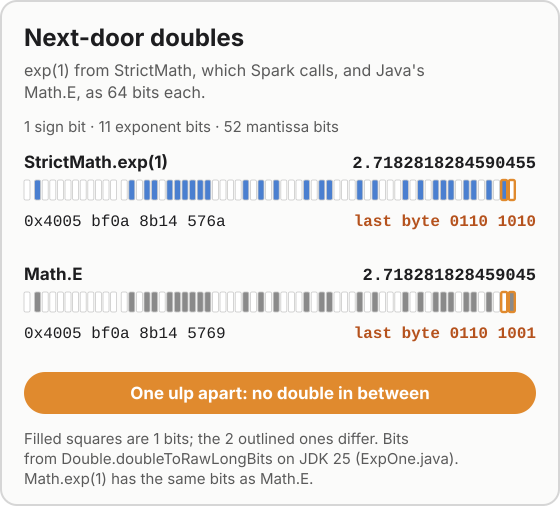
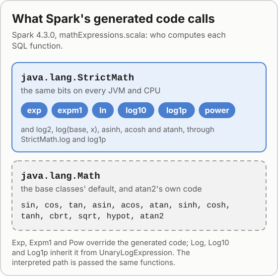
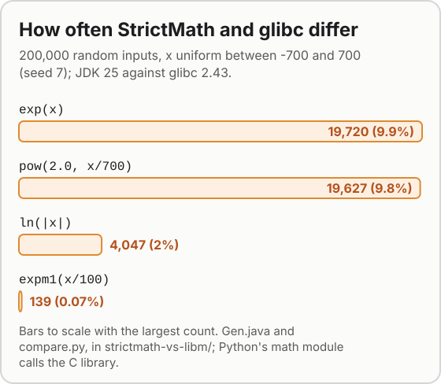
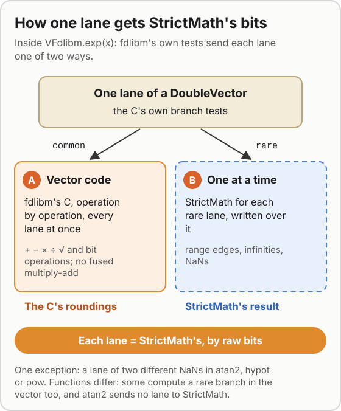
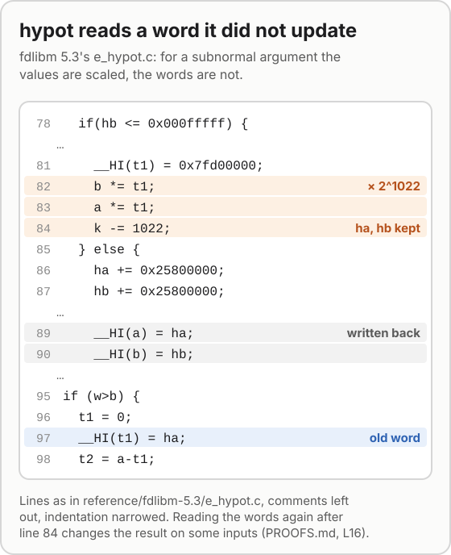
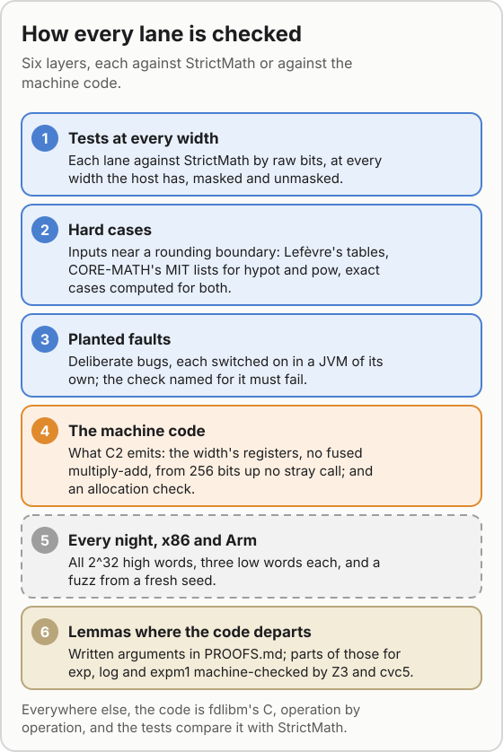

<!-- Set `date` to the real date when the post is published, and remove `published: false` at the
     release; until then Jekyll does not publish the post even if Pages is enabled. -->

<!-- A draft for vfdlibm 0.3.0. Every link to github.com/vecbricks/vfdlibm/blob/v0.3.0/ and
     tree/v0.3.0/ resolves only once the tag v0.3.0 exists, and the links to files under docs/blog/
     only if this branch is merged before the tag is made. -->
<!-- N in the title must be a figure of the README's generated speedup table at v0.3.0: the
     largest "common" figure among the rows exp, log and pow in the xeon8573c (AVX-512) column,
     as the table prints it. Until that table exists there is no N; do not put in another figure. -->
<!-- The figures under img/ are written by figures.py from the data under strictmath-vs-libm/data/;
     edit the script, not the SVG files. -->

<div class="summary" markdown="1" style="border: 1px solid #d6d6d6; border-radius: 12px; padding: 4px 16px; margin-bottom: 1.5em;">

**In short.** vfdlibm computes Spark's math functions on whole vectors of doubles, and every lane
gets the same bits as `java.lang.StrictMath`, which Spark calls. That matters because the bits
differ elsewhere: Spark's `exp(1)` is the double just above Java's `Math.E`. And on 32 test
inputs on my Databricks warehouse, Photon returned the C library's results, not Spark's.

</div>

## Spark's e is not Java's e

Spark computes `exp`, `ln` and `power` with a different library than Java's `Math`, and you can
see it in the last bits.

Ask Java for e and you get `Math.E`, 2.718281828459045. Ask Spark SQL for `exp(1)` and you get
2.7182818284590455. The two are neighbours: no double lies between them.

[](img/exp1-bits.svg)

Spark does this on purpose. Its code for these functions calls `java.lang.StrictMath`, not
`java.lang.Math`, in the generated code and in the interpreter alike.

[](img/spark-emits.svg)

The difference is a promise. `Math` is allowed to be faster, and its Javadoc says its
implementations "are not defined to return the bit-for-bit same results". `Math.exp` promises a
result "within 1 ulp of the exact result". An ulp, a unit in the last place, is the gap between a
double and the next one. So `Math.exp` may return either neighbour, and the JIT may pick code
written for your CPU.

`StrictMath` promises one algorithm: "The Java math library is defined with respect to fdlibm
version 5.3." fdlibm is Sun's Freely Distributable Math Library, written in C. The
same input gives the same 64 bits on every JVM and every CPU. A query run on another cluster
returns the same doubles, and a test that compares them passes there too.

## Photon returns other doubles

On my workspace, Photon's results matched the C library's, not Spark's.

I wanted to see what the promise looks like outside the JVM. On 24 November 2026 I ran a small
test on my own Databricks SQL warehouse with Photon. It reads 32 inputs from a table, eight each
for `exp`, `ln`, `expm1` and `pow(2, x)`. I picked inputs where `StrictMath` and glibc 2.43, the
C library on my laptop, give different doubles. `EXPLAIN` said Photon ran the whole query.

[](img/who-returns-what.svg)

Read the grid by columns. Apache Spark 4.2.0, run on my laptop, returned `StrictMath`'s result
every time. Photon returned glibc's every time.

Two more columns narrow it down. On three inputs `StrictMath` is the correctly rounded one, the
double nearest the exact value, and Photon still matched glibc. So Photon is not merely accurate.
glibc also has a vector library, libmvec, and its AVX2 functions disagree with scalar glibc on 17
inputs. Photon matched the scalar ones. The caption says what this does not rule out.

How often do the two libraries disagree? On my random inputs, about one `exp` in ten.

[](img/how-often.svg)

A query of literals would have hidden all this. `SELECT EXP(1)` on the warehouse returned
`StrictMath`'s value. Spark's optimizer folds constant expressions on the driver, in the JVM, so
this query does not exercise Photon. I have not yet compared a literal with the same value read from a
column.

<!-- {{LITERAL_VS_COLUMN}}: owner to run SELECT exp(1.0D), (SELECT exp(x) FROM tmp_math WHERE x = 1.0D) and add the result if they differ -->

Other engines do not promise `StrictMath`'s bits either. NVIDIA's
[cuDF plugin for Apache Spark](https://nvidia.github.io/cudf-spark/docs/compatibility.html) says:
"For other functions like sin, cos, etc. the output may be different, but within the rounding
error inherent in floating-point calculations." And Velox's Presto `exp` calls `std::exp`
([`ExpFunction`](https://github.com/facebookincubator/velox/blob/b0706264be6ce974388fc263197c2a9e013416d2/velox/functions/prestosql/Arithmetic.h#L336-L340)).

You can run the same test on your engine. The query is at the end of this post.

## vfdlibm: Spark's bits, a vector at a time

vfdlibm gives every lane of a vector the same bits as `StrictMath`.

The Vector API (`jdk.incubator.vector`, still incubating in JDK 25) lets Java run one operation
on several doubles at once. Each double is a *lane*. The vector's shape is its *species*: a
512-bit species holds eight lanes.

vfdlibm ports fdlibm's C to that API. Version 0.3.0 has thirteen functions: `exp`, `expm1`,
`log`, `log10`, `log1p`, `pow`, `sinh`, `cosh`, `asin`, `acos`, `atan`, `atan2` and `hypot`.
`hypot` and `pow` are new. Every lane equals `StrictMath`'s result, compared bit for bit with
`Double.doubleToRawLongBits`. There is one exception, and the first surprise below explains it.

[](img/one-call.svg)

Inside a call, fdlibm's own tests sort the lanes. Ordinary lanes go through the vector code,
which is fdlibm's C, operation by operation. In most functions, a rare lane (an edge of the
range, an infinity or a NaN) is computed again by `StrictMath` itself and written over the lane.

### Nine lines of code

Add the dependency, `io.github.vecbricks:vfdlibm:0.3.0`, to a pom that compiles for Java 25 (the
README has the [whole pom](https://github.com/vecbricks/vfdlibm/blob/v0.3.0/README.md#use)):

```xml
<dependency>
  <groupId>io.github.vecbricks</groupId>
  <artifactId>vfdlibm</artifactId>
  <version>0.3.0</version>
</dependency>
```

The method `exp` below is the part that matters. It loads a vector from `xs`, computes it, and
stores the result in `ys`. The few doubles at the end that do not fill a vector go to
`StrictMath`. `main` checks every result:

```java
package example;

import io.github.vecbricks.vfdlibm.VFdlibm;
import jdk.incubator.vector.DoubleVector;
import jdk.incubator.vector.VectorSpecies;

public final class Main {
  static final VectorSpecies<Double> S = DoubleVector.SPECIES_PREFERRED;

  static void exp(double[] xs, double[] ys) {
    int i = 0;
    for (; i < S.loopBound(xs.length); i += S.length()) {
      VFdlibm.exp(DoubleVector.fromArray(S, xs, i)).intoArray(ys, i);
    }
    for (; i < xs.length; i++) {
      ys[i] = StrictMath.exp(xs[i]); // the tail that does not fill a whole vector
    }
  }

  public static void main(String[] args) {
    double[] xs = new double[1_000_003];
    double[] ys = new double[xs.length];
    for (int k = 0; k < xs.length; k++) {
      xs[k] = (k - 500_000) * 1e-3; // -500.0 to 500.002
    }
    exp(xs, ys);
    long differ = 0;
    for (int k = 0; k < xs.length; k++) {
      long want = Double.doubleToRawLongBits(StrictMath.exp(xs[k]));
      if (Double.doubleToRawLongBits(ys[k]) != want) {
        differ++;
      }
    }
    System.out.println(S.vectorBitSize() + "-bit vectors, " + xs.length
        + " inputs, results that differ from StrictMath's: " + differ);
  }
}
```

The JVM loads an incubating module only when told to:

```sh
mvn -q compile org.apache.maven.plugins:maven-dependency-plugin:3.7.0:build-classpath \
  -Dmdep.outputFile=cp.txt
java --add-modules jdk.incubator.vector -cp "target/classes:$(cat cp.txt)" example.Main
```

On my laptop, which has 512-bit vectors, it prints a warning about the incubator module, then:

```
512-bit vectors, 1000003 inputs, results that differ from StrictMath's: 0
```

## How much faster

The speedup comes from benchmark files in the repository, and the README's
[table](https://github.com/vecbricks/vfdlibm/blob/v0.3.0/README.md) is generated from them.

<!-- The figure img/speedup.svg is a placeholder: at release, generate the bars from the README's
     v0.3.0 speedup table and replace it. -->
[](img/speedup.svg)


- `exp` on the Intel Xeon Platinum 8573C (AVX-512): {{row: exp xeon8573c}}
- `exp` on the AMD EPYC 7763 (AVX2): {{row: exp epyc7763}}


These are timings of a loop over an array, not of a query. A query gains only as much as it
spends in these functions. "Common" data has no rare lanes, and "mixed" data has some. The hosts
are GitHub-hosted virtual machines, and "How I checked" says how the numbers are taken.

## Why not `VectorOperators.EXP`?

The Vector API has its own `EXP`, but it promises accuracy, not `StrictMath`'s bits.

Its Javadoc, in the section ["Operations on floating point
vectors"](https://docs.oracle.com/en/java/javase/25/docs/api/jdk.incubator.vector/jdk/incubator/vector/VectorOperators.html),
says:

> Lane-wise vector operations that apply to floating point vectors follow the accuracy and
> monotonicity specifications of the equivalent Java operation or method mentioned in its
> documentation unless specified otherwise.

And `EXP` itself adds: "Not guaranteed to be semi-monotonic."

That is the kind of promise `Math` makes. An operator that sometimes returns the other neighbour
keeps it. I have not measured how often `VectorOperators.EXP` differs from `StrictMath`, or how
fast it is. I only read what it promises.

[](img/compare.svg)

## Three surprises

### 1. StrictMath's NaN depends on the JIT

The same call can return a different NaN, depending on how far the JIT has compiled it.

A NaN, "not a number", carries spare bits, its payload. What should `atan2` return when both of
its arguments are NaNs with different payloads? This program,
[`NanTier.java`](https://github.com/vecbricks/vfdlibm/blob/v0.3.0/docs/blog/NanTier.java), asks
two million times:

```java
public class NanTier {
  public static void main(String[] a) {
    double x = Double.longBitsToDouble(0x7ff8000000000001L), y = Double.longBitsToDouble(0x7ff8000000000002L);
    long first = 0, second = 0, other = 0;
    for (int i = 0; i < 2_000_000; i++) {
      long r = Double.doubleToRawLongBits(StrictMath.atan2(x, y));
      if (r == 0x7ff8000000000001L) first++; else if (r == 0x7ff8000000000002L) second++; else other++;
    }
    System.out.println("atan2(NaN#1, NaN#2): first=" + first + " second=" + second + " other=" + other);
  }
}
```

[](img/nan-tier.svg)

In the interpreter, every call returned the first NaN. With the JIT on, some returned the second.
On this one kind of input, `StrictMath` does not agree with itself.

No code can match a target that moves. So vfdlibm's contract has one exception. In `atan2`,
`hypot` and `pow`, a lane where both arguments are NaNs with different bits returns one of the two
NaNs, quieted (and for `hypot`, with the sign cleared). Which one is not specified. Every other
lane keeps the bit-for-bit rule ([`AGENTS.md`,
"Releases"](https://github.com/vecbricks/vfdlibm/blob/v0.3.0/AGENTS.md#releases)).

### 2. hypot reads a word it did not update

fdlibm's `hypot` keeps using a value that looks out of date, and the result depends on it.

[](img/hypot-stale.svg)

For a subnormal argument, `hypot` multiplies both values by 2^1022. It keeps the high words, the
top 32 bits, that it read before. A few lines later it splits the scaled values at those old
words. It looks like a bug.

It is not one to fix. Reading the words again gives other doubles on some inputs, so the vector
code keeps the old words too, as the C does.
[`HypotTest`](https://github.com/vecbricks/vfdlibm/blob/v0.3.0/src/test/java/io/github/vecbricks/vfdlibm/HypotTest.java)
pins four such inputs.

### 3. Fast code can quietly turn into slow code

When the JIT cannot keep a vector in registers, it turns it into an object on the heap. That is
called boxing. The results stay right, so every test still passes. Only the allocation shows it.

[](img/boxing.svg)

So CI fails a benchmark that allocates. It also reads the machine code the JIT emits for every
function. It checks the register width, stray calls, and fused multiply-adds. A fused
multiply-add computes `a * b + c` with one rounding instead of two, which changes results, so none
may appear.

## What it does not do yet

`sin`, `cos`, `tan`, `tanh` and `cbrt` are not ported; whether they will be is open in
[#162](https://github.com/vecbricks/vfdlibm/issues/162). `pow` computes its common case in the
vector and sends the rest to `StrictMath.pow` one lane at a time, `pow(x, 2.0)` and `pow(x, 0.5)`
included ([#34](https://github.com/vecbricks/vfdlibm/issues/34)). It needs JDK 25, where the
Vector API is still an incubator module. On x86, 128-bit vectors run the Vector API's Java
fallback. And at `SPECIES_MAX`, only vectors of up to eight lanes are known not to allocate.

## Try it

`io.github.vecbricks:vfdlibm:0.3.0` is on Maven Central, and the source is at
[github.com/vecbricks/vfdlibm](https://github.com/vecbricks/vfdlibm). Next come the decision on
the five functions above ([#162](https://github.com/vecbricks/vfdlibm/issues/162)) and profiles
of where the time goes ([#156](https://github.com/vecbricks/vfdlibm/issues/156)).

{{VARKA: owner writes one or two sentences on Varka}}

<div class="box" markdown="1" style="border: 1px solid #d6d6d6; border-radius: 12px; padding: 0 16px; margin-top: 2em;">

## Check your own engine

Which doubles does your SQL engine return: `StrictMath`'s, like Spark's, or another library's?
Each row below holds an input and both libraries' results, and `matches` says which one your
engine returned. This is the form I ran on Databricks. On Apache Spark without Delta, replace the
first line with `DROP TABLE IF EXISTS tmp_photon_math` and
`CREATE TABLE tmp_photon_math (...) USING parquet`. Four of the 32 rows are shown;
[`photon-check.sql`](https://github.com/vecbricks/vfdlibm/blob/v0.3.0/docs/blog/photon-check.sql)
has them all.

```sql
CREATE OR REPLACE TABLE tmp_photon_math (f STRING, x DOUBLE, strictmath DOUBLE, libm DOUBLE);
INSERT INTO tmp_photon_math VALUES
  ('exp', 398.66376279136523D, 1.372373473676344e+173D, 1.3723734736763437e+173D),
  ('ln', 212.36641575624026D, 5.3583131589573565D, 5.358313158957356D),
  ('expm1', 1.7622825689472796D, 4.825719836785396D, 4.825719836785395D),
  ('pow', 0.4983392062672662D, 1.4125864924923173D, 1.412586492492317D);

SELECT f, x, photon,
       CASE WHEN photon = strictmath THEN 'StrictMath (Spark)'
            WHEN photon = libm THEN 'glibc libm'
            ELSE 'neither' END AS matches
FROM (
  SELECT f, x, strictmath, libm,
         CASE f WHEN 'exp' THEN exp(x) WHEN 'ln' THEN ln(x)
                WHEN 'expm1' THEN expm1(x) WHEN 'pow' THEN pow(2.0D, x) END AS photon
  FROM tmp_photon_math)
ORDER BY f, x;
```

</div>

## How I checked

**Spark's sources.** The file is
[`mathExpressions.scala`](https://github.com/apache/spark/blob/v4.3.0/sql/catalyst/src/main/scala/org/apache/spark/sql/catalyst/expressions/mathExpressions.scala)
at Spark 4.3.0. The base class
[`UnaryMathExpression`](https://github.com/apache/spark/blob/v4.3.0/sql/catalyst/src/main/scala/org/apache/spark/sql/catalyst/expressions/mathExpressions.scala#L66-L87)
generates `java.lang.Math.<name>(x)`. `Exp` and `Expm1` override it with `StrictMath`
([L571](https://github.com/apache/spark/blob/v4.3.0/sql/catalyst/src/main/scala/org/apache/spark/sql/catalyst/expressions/mathExpressions.scala#L571-L576),
[L592](https://github.com/apache/spark/blob/v4.3.0/sql/catalyst/src/main/scala/org/apache/spark/sql/catalyst/expressions/mathExpressions.scala#L592-L597)),
and so does `Pow`
([L1428](https://github.com/apache/spark/blob/v4.3.0/sql/catalyst/src/main/scala/org/apache/spark/sql/catalyst/expressions/mathExpressions.scala#L1428-L1435)).
`Log`, `Log10` and `Log1p` inherit `StrictMath` from
[`UnaryLogExpression`](https://github.com/apache/spark/blob/v4.3.0/sql/catalyst/src/main/scala/org/apache/spark/sql/catalyst/expressions/mathExpressions.scala#L89-L115).
The interpreted path is passed the same functions, such as
`UnaryMathExpression(StrictMath.exp, "EXP")`.

**The Java quotes** are from the JDK 25 Javadoc of
[`Math`](https://docs.oracle.com/en/java/javase/25/docs/api/java.base/java/lang/Math.html) and
[`StrictMath`](https://docs.oracle.com/en/java/javase/25/docs/api/java.base/java/lang/StrictMath.html).
The bits of `exp(1)` come from
[`ExpOne.java`](https://github.com/vecbricks/vfdlibm/blob/v0.3.0/docs/blog/strictmath-vs-libm/ExpOne.java).

**The Photon run**, on my workspace on 24 November 2026. A first query of literals,
`SELECT EXP(1), LOG(E(), 10), pow(2, 0.5), EXPM1(1.0E-5)`, returned 2.7182818284590455,
2.302585092994046, 1.4142135623730951 and 0.000010000050000166668. For a query over a table
column, `EXPLAIN` showed `PhotonProject [... EXP(x), ln(x), pow(2.0, x), EXPM1(x)]` over
`PhotonScan parquet` and said "The query is fully supported by Photon." The test is
[`photon-check.sql`](https://github.com/vecbricks/vfdlibm/blob/v0.3.0/docs/blog/photon-check.sql);
Photon's results are in `photon-2026-11-24.csv`, and on every row they equal the file's `libm`
column.

**The Apache Spark run** used Apache Spark 4.2.0's `spark-sql` in local mode on JDK 21, on my
laptop, with the same file and a parquet table. Its results are in
`spark-4.2.0-local-2026-11-24.csv`, and every row matched `StrictMath`.

**The two follow-up tests.**
[`rounding.py`](https://github.com/vecbricks/vfdlibm/blob/v0.3.0/docs/blog/strictmath-vs-libm/rounding.py)
computes each of the 32 results with Python's `decimal` at 80 digits and rounds it to a double.
The three inputs where `StrictMath` is the correctly rounded one are all `expm1`: at
3.178803427426695, 1.0542424180475716 and 1.0400925680121542.
[`libmvec.c`](https://github.com/vecbricks/vfdlibm/blob/v0.3.0/docs/blog/strictmath-vs-libm/libmvec.c)
calls glibc's AVX2 functions `_ZGVdN4v_exp`, `_ZGVdN4v_log`, `_ZGVdN4v_expm1` and `_ZGVdN4vv_pow`
on the same inputs. For example, libmvec gives 1.4125864924923173 for `pow(2, 0.4983392062672662)`,
where scalar glibc gives 1.412586492492317. Both ran on glibc 2.43, x86-64 with AVX2.

**The rates** come from
[`Gen.java` and `compare.py`](https://github.com/vecbricks/vfdlibm/tree/v0.3.0/docs/blog/strictmath-vs-libm):
200,000 inputs drawn uniformly between -700 and 700 from seed 7, with `ln` of the absolute value,
`expm1` of x/100 and `pow(2.0, x/700)`. Python's `math` module calls the C library. The data of
every figure is in `strictmath-vs-libm/data/`, and
[`figures.py`](https://github.com/vecbricks/vfdlibm/blob/v0.3.0/docs/blog/figures.py) draws the
figures from it.

**The speed numbers** are kernel timings: `StrictMath` called once per lane against vfdlibm at the
host's preferred species. The hosts are an Intel Xeon Platinum 8573C (AVX-512) and an AMD EPYC
7763 (AVX2). Each figure is by minimum time; where a file holds a run and its re-run, the lower of
the two ratios. vfdlibm's body is inlined into the loop
(`-XX:CompileCommand=inline,io.github.vecbricks.vfdlibm.*::*`), the project's fixed method: a
call that C2 does not inline passes its vectors as objects
([`PLAN.md`](https://github.com/vecbricks/vfdlibm/blob/v0.3.0/PLAN.md), section 2).

**hypot's old words.**
[`PROOFS.md`'s L16](https://github.com/vecbricks/vfdlibm/blob/v0.3.0/PROOFS.md#l16-the-stale-words-of-the-21022-scaling-cannot-be-refreshed-a-counter-example-not-a-fold)
lists four inputs where reading the words again changes the result. Of 1,048,576 pairs with a
subnormal argument (seed 42), 914,446 took the 2^1022 path, and on 42,876 the result differed, as
counted by a scratch program that is not committed. Which answer is closer to the exact value is
not measured.

**Boxing and the machine code.** The allocation figures are from
[`exp-xeon8573c-2026-11-21.txt`](https://github.com/vecbricks/vfdlibm/blob/v0.3.0/bench/results/exp-xeon8573c-2026-11-21.txt).
CI runs an allocation check at 256 bits, the preferred species and `SPECIES_MAX`, and fails a row
that reaches one byte per operation; 128 bits on x86 is known to box and is left out, and `pow` is
held to a baseline, since `StrictMath.pow` allocates itself. `AsmTest`
([`SKILLS.md`, "The assembly check"](https://github.com/vecbricks/vfdlibm/blob/v0.3.0/SKILLS.md#the-assembly-check))
reads what C2 emits; its rule on calls holds from 256 bits up.

**How the bits are kept.**

[](img/checks.svg)

The code follows fdlibm 5.3's C operation by operation. It is ported from Sun's sources only,
never from OpenJDK's `FdLibm.java`, which is GPLv2 with the Classpath exception; `StrictMath` is
only the oracle the tests call. Where the code computes differently from the C, a numbered lemma
in [`PROOFS.md`](https://github.com/vecbricks/vfdlibm/blob/v0.3.0/PROOFS.md), a written argument,
shows the result is the same double for every input. Parts of the lemmas for `exp`, `log` and
`expm1` are machine-checked in
[`proofs/`](https://github.com/vecbricks/vfdlibm/tree/v0.3.0/proofs) by an SMT solver on every
pull request, and under both Z3 and cvc5 every night. The tests compare every lane with
`StrictMath` at every width the host has. Each planted fault, a deliberate bug switched on in a
test run, must be caught. Every night,
[`nightly.yml`](https://github.com/vecbricks/vfdlibm/blob/v0.3.0/.github/workflows/nightly.yml)
is set to sweep all 2^32 high words of every function, three low words each: on x86 at 256 bits,
the widest species, and 512 bits when the runner has AVX-512; on Arm at 128 bits. The 128-bit
sweep on x86 covers a rotating 1/32 of the words a night. A function of two arguments has one
argument swept a night, and a fuzzer draws inputs from a fresh seed at every width.
