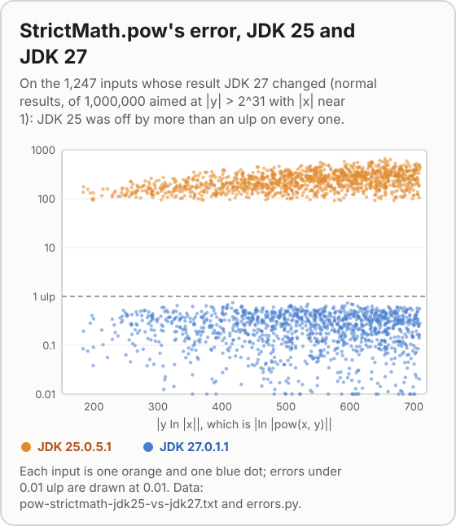
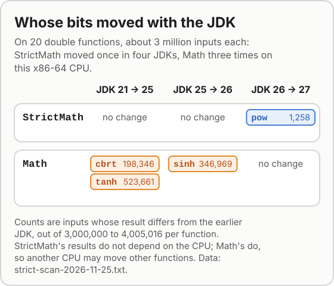

# Even StrictMath is not frozen: JDK 27 changed pow's bits, and it was right to

<!-- Published on vecbricks.github.io as a page built by ../page.py (its docstring has the
     command); this file is the prose, and img/*.svg, from figures.py here, are the figures. -->

<div class="summary" markdown="1" style="border: 1px solid #d6d6d6; border-radius: 12px; padding: 4px 16px; margin-bottom: 1.5em;">

**In short.** `java.lang.StrictMath` is the part of Java that promises the same bits everywhere,
and Spark relies on it for `power`, `exp`, `ln` and their relatives. JDK 27 changed what
`StrictMath.pow` returns on some inputs, on purpose: the old results there were up to 653 ulps
off. The same Spark query now gives another double on JDK 27 than on JDK 25. The change is
rare, and it is a fix, but "the same bits as `StrictMath`" turns out to be a promise per JDK.

</div>

## One query, two JDKs

This is Apache Spark 4.3.0, the same query on the same laptop, once with `JAVA_HOME` at JDK 25
and once at JDK 27:

```sql
SELECT power(1.0000000005093685D, -7.760027956194805E9D);
```

| Spark 4.3.0 on | result |
|---|---|
| JDK 25.0.5.1 | 0.01920251216909316 |
| JDK 27.0.1.1 | 0.019202512169093165 |

Spark's `power` calls `StrictMath.pow`, so the result follows the JVM it runs on. The two
results are one ulp apart, and the new one is the correctly rounded one: the exact value is
0.01920251216909316303…, 0.57 ulp from JDK 25's result and 0.43 ulp from JDK 27's.

The reason is one sentence of `StrictMath`'s Javadoc. [JDK 25's](https://docs.oracle.com/en/java/javase/25/docs/api/java.base/java/lang/StrictMath.html) reads:

> The Java math library is defined with respect to `fdlibm` version 5.3.

[JDK 27's](https://docs.oracle.com/en/java/javase/27/docs/api/java.base/java/lang/StrictMath.html) reads:

> The Java math library is defined with respect to `fdlibm` version 5.3 with a fix to `pow` so
> that its error bounds conform to the quality of implementation criteria for `pow`.

## The fix was real

The change is [JDK-8326547](https://bugs.openjdk.org/browse/JDK-8326547), "StrictMath.pow
returns results outside of a 1 ulp error bound", integrated into the JDK's main line on
21 May 2026 ([openjdk/jdk#31210](https://github.com/openjdk/jdk/pull/31210)), and so in JDK 27.
It touches one branch of fdlibm's `pow`: `|y|` above 2<sup>31</sup> with `|x|` within about
2<sup>-20</sup> of 1.

I compared `StrictMath.pow` on JDK 25 and JDK 27 on a million inputs aimed at that branch:
500,262 have `|x|` within 2<sup>-20</sup> of 1, and 389,513 of those reach the changed code (a
negative `x` with a non-integer `y` returns NaN first). The results differ on 1,258. On each of the 1,247 with a normal result, JDK 25 was at least
91 ulps off, and up to 653; JDK 27 is within 0.74 ulp on all of them.

[](img/pow-errors.svg)

So the old results broke `StrictMath`'s own contract, which allows 1 ulp, and JDK 27 repaired
them: a fix, not a regression.

## It is a corner

Those 1,258 inputs were aimed at the branch. Elsewhere the change is hard to reach:

- On 3,005,016 other inputs (vfdlibm's hard cases for `pow`, uniformly random bits, moderate
  magnitudes and values near 1), no result changed.
- The 1,258 all have `||x| - 1|` between about 2<sup>-23.5</sup> and 2<sup>-21.6</sup>, and `|y|`
  between 2<sup>31</sup> and about 2<sup>33</sup>, so their results are beyond
  10<sup>±79</sup>.
- With `|x - 1|` below 2<sup>-24</sup> and `|y|` from 2<sup>31</sup> to 2<sup>33</sup> (results
  from about e<sup>±0.1</sup> to e<sup>±500</sup>), 17 of 4,000,000 results changed, the query
  above among them, including some with results as large as those of the 1,258. There both JDKs
  are within 1 ulp; JDK 27's result is the nearer on 5 and JDK 25's on 12, too few to call either
  better. So the large errors came with `||x| - 1|` near 2<sup>-22</sup>, not with the size of
  the result.
- Per-second compounding, `(1 + r/n)^(n·t)` with `n` the seconds in a year, reaches the branch
  once `n·t` passes 2<sup>31</sup>, about 68 years. Over rates from 0.01% to 20% and 70 to 300
  years, none of its 462,000 results changed.

JDK 26 got the same fix in its update 26.0.2
([JDK-8385665](https://bugs.openjdk.org/browse/JDK-8385665),
[openjdk/jdk26u#210](https://github.com/openjdk/jdk26u/pull/210)), but in `Math.pow` only:
`StrictMath.pow` on JDK 26 still returns fdlibm 5.3's bits. On my x86-64 laptop even that
`Math.pow` change is invisible by default, since the JIT uses its own `pow` there; with
`-XX:-UseLibmIntrinsic` it shows, on the same 1,258 inputs and with JDK 27's bits (elsewhere
that fallback returns `StrictMath.pow`'s bits, but for the sign of a NaN result).

## StrictMath moved once; Math moved three times

To see what else moves, I ran 20 double functions of `StrictMath`, the transcendental ones and
their relatives with `sqrt` and `IEEEremainder` as controls, and `Math`'s counterparts, on JDK 21, 25, 26 and 27, about 3 million inputs each.

[](img/moved.svg)

`StrictMath` changed once in four JDKs, in one function, with a bug record and a Javadoc
sentence. `Math` changed three times on this CPU, with no change to its Javadoc: `cbrt` and `tanh` from JDK 21 to
25, `sinh` from 25 to 26, each on 7% to 17% of the inputs. That is allowed, since `Math`
only promises to be within an ulp or so, and the JIT picks its code per CPU; another CPU may move
other functions.

So the contrast from the [last post](https://vecbricks.github.io/strictmath-at-simd-speed/) holds,
with one correction. There I wrote that `StrictMath` gives "the same 64 bits on every JVM and
every CPU". That is true within a JDK version, and across 21, 25 and 26 on everything I tried;
from JDK 27, `pow` is the exception.

## Rare per row, certain at scale

After the last post a reader wrote that "a single ulp can spiral into massive errors with big
data". It does not spiral: rows do not feed each other in a `SELECT` or a `SUM`, and over a
million rows the sums of `exp(x)` on Spark and on Photon differed by 3.6 parts in 10<sup>19</sup>.
What does grow with the table is the number of rows where an ulp lands on a boundary and changes
a decision.

To count them I took money arithmetic: `amount * POWER(1 + rate, years)` and
`amount * EXP(rate * years)`, with amounts up to a million in whole cents, rates in basis points
up to 20% and 1 to 40 years, computed once with fdlibm (`StrictMath`'s bits) and once with
glibc 2.43, then rounded to cents.

| rows | amounts that differ | cents that differ, `POWER` | cents that differ, `EXP` |
|---|---|---|---|
| 10<sup>9</sup> | 8.2% (`POWER`), 8.8% (`EXP`) | 30 | 59 |
| 10<sup>10</sup> | 8.2%, 8.8% | 291 | 417 |

About one row in twelve (`POWER`) or eleven (`EXP`) gets a different amount, so a join, a `GROUP BY` or an equality test
on these amounts sees two values for it. Different cents are far rarer, but ten times the rows
gave seven to ten times as many. Two of them, checked end to end on Spark 4.3.0:

| | Spark (`StrictMath`) | glibc's double, rounded by Spark |
|---|---|---|
| 874,292.44 × `exp(0.1342 × 39)` | 163,933,300.**40** | 163,933,300.**41** |
| 857,486.34 × `power(1.1820, 40)` | 688,535,397.**45** | 688,535,397.**44** |

Two notes on that count. It is fdlibm against glibc, the difference between Spark and an engine
that calls the C library, not JDK 25 against JDK 27: with at most 40 years, `power(1 + rate,
years)` never reaches the branch JDK 27 changed. And it rounds as Spark's `round` does, from the
double's shortest decimal: `round(24471612.324999999D, 2)` is 24471612.33 on Spark, though the
double is below the half cent. Which rule another engine uses I have not measured.

## What it means for vfdlibm

[vfdlibm](https://github.com/vecbricks/vfdlibm) computes `pow` on whole vectors with the same
bits as `StrictMath`. On the inputs above it still does, on JDK 25, 26 and 27: 0 lanes of
4,005,016 differ, at 256 and 512 bits. That is less clever than it sounds. vfdlibm computes in the
vector only the lanes with `|y|` up to about 2<sup>31</sup>, and hands each rarer lane to
`StrictMath.pow` itself, so on the branch JDK 27 changed it returns whatever the running JDK
returns.

It supports JDK 25 only, and stays so until a newer JDK has been checked function by function;
[issue #175](https://github.com/vecbricks/vfdlibm/issues/175) holds what is known. Where
`StrictMath` departs from fdlibm, vfdlibm's rule is to follow `StrictMath`, as it already does
for `hypot`'s argument order; how one release would serve two JDKs whose `StrictMath` differs is
the question #175 leaves open.

## What I would do

- Treat "the same bits as `StrictMath`" as "the same bits as `StrictMath` on this JDK". Record the
  JDK version next to results you compare by bits, such as golden files, checksums or hashes.
- Expect a JDK upgrade to move `Math`'s results, and now and then `StrictMath`'s, and read the
  release notes for both.
- Do not join, group or deduplicate on a computed double you do not control, and round once, at
  the end.

## How I checked

Everything is in
[docs/blog/strictmath-not-frozen](https://github.com/vecbricks/vfdlibm/tree/main/docs/blog/strictmath-not-frozen),
with each data file's provenance at its top. The JDKs were Ubuntu 26.04's 21.0.13.1, 25.0.5.1 and
26.0.2, and 27.0.1.1 from jdk.java.net, on an AMD Ryzen AI 9 HX PRO 370; vfdlibm was 0.3.0 from
Maven Central; Spark was the official 4.3.0 build, checked against Apache's SHA-512.

- `JdkScan.java` and `compare.py`: vfdlibm's 13 functions on JDK 25, 26 and 27, with vfdlibm
  checked against each ([jdk-scan-2026-11-25.txt](https://github.com/vecbricks/vfdlibm/blob/main/docs/blog/strictmath-not-frozen/data/jdk-scan-2026-11-25.txt));
  the 1,258 inputs with both results are in `pow-strictmath-jdk25-vs-jdk27.txt`.
- `StrictScan.java`: those 20 functions of `StrictMath` and `Math` on JDK 21 to 27
  ([strict-scan-2026-11-25.txt](https://github.com/vecbricks/vfdlibm/blob/main/docs/blog/strictmath-not-frozen/data/strict-scan-2026-11-25.txt)).
- `errors.py`, `Moderate.java`, `Compound.java` and `power-jdk.sql`: the errors against an
  80-digit `pow`, the ordinary sizes, the compounding and the Spark query
  ([pow-jdk27-detail-2026-11-25.txt](https://github.com/vecbricks/vfdlibm/blob/main/docs/blog/strictmath-not-frozen/data/pow-jdk27-detail-2026-11-25.txt)).
- `flips.c`, `FlipsCheck.java` and `round-check.sql`: the cents, with fdlibm checked against
  `StrictMath` first
  ([cents-fdlibm-vs-glibc-2026-11-25.txt](https://github.com/vecbricks/vfdlibm/blob/main/docs/blog/strictmath-not-frozen/data/cents-fdlibm-vs-glibc-2026-11-25.txt)).

The bug records' facts are from their public pull requests and the two Javadoc pages; no JDK
source was read for this post.
